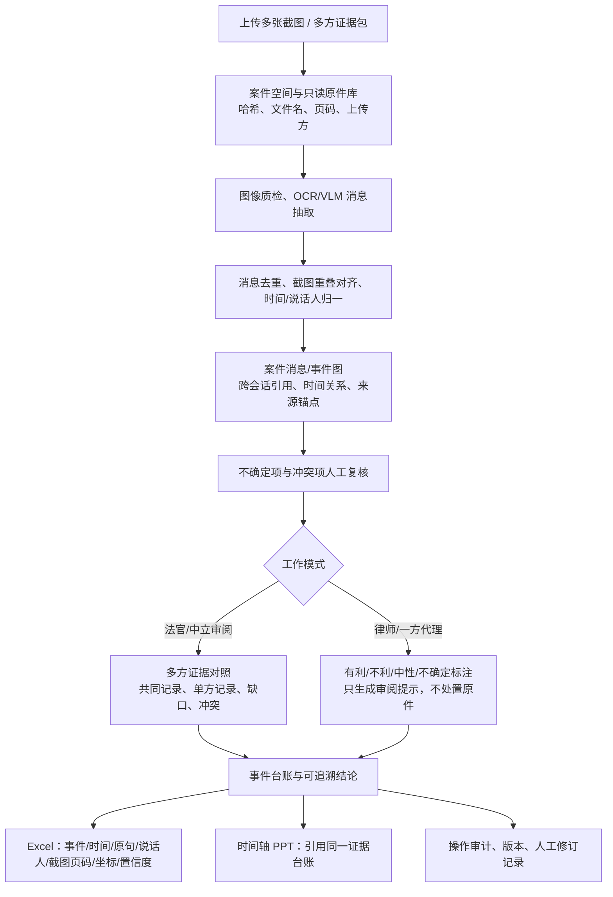

# 微信聊天截图法律证据项目：重启蓝图

盘点日期：2026-10-04  
目标：先重启高难度数据集与模型评测，再逐步形成面向律师的证据整理工具。

用户已确认：研究数据以判决书为来源生成可能的聊天截图，分为中文判决书→微信截图、英文判决书→WhatsApp 截图两条支线；判决书明确引用的聊天原文也应保留。推理不强制本地，但系统必须保留云端/本地模式切换。用户确认 `归档.zip` 中的 Excel 均为飞书多维表格原始导出；后续对这些源表只读盘点和建映射，不直接覆盖。

已读取 ChatGPT 项目“毕业论文_valeria”中的部分相关对话。旧路线把 ScreenshotLegalBench 当前稿称为 v1（KIE + 全局 VQA，含多图案由问题），将消息级 intent/event_id/显式时间线规划为 v2；后续讨论过 ProofRank、TimeLaw、Ask-to-Reason 等研究方向。对话中所称“106 个多图案件”及附件中的样本数量仍需回到数据清单核验；讨论中提出的 prompt pilot 百分比是建议写作示例，不能当成实际实验结果。

## 1. 建议先定的产品原则

研究数据中的截图是根据判决材料构造的合成样本，不是真实聊天原件。每个消息片段必须记录其来源类型：判决书逐字引用的聊天原文、判决书对聊天的转述、或模型生成的合成补充；不能把后两类伪装成当事人的原始消息。逐字引文需保留判决书文件/案号、页码和原文片段；转述只能作为生成约束或事实背景。

产品运行时则是“证据材料整理与核验辅助”，不是自动认定事实或替代律师/法官的系统。任何提取结果都要能回到用户上传的原始截图、图片页码和消息区域；模型不能补写原始聊天、推断后冒充确定时间、也不能修改或删除原始证据。云端/本地是可配置的推理部署选项；切换方式、数据出站提示、密钥管理及供应商数据保留策略都要纳入验收。

尤其要调整律师模式的“倾向删除不利记录”：产品可以在有权限的工作空间中标出对委托方不利、矛盾或待解释的内容，供律师审查；原始材料必须只读留存，不能提供删除、隐匿或篡改证据的操作。输出应明确区分原件、模型提取、人工修改和律师工作成果。

## 2. 现有资产盘点

### 当前可复用的部分

| 资产 | 本地核验到的内容 | 可复用方向 | 主要限制 |
| --- | --- | --- | --- |
| `ScreenshotLegalBench_v2` | 判决解析/抽样、判决到聊天生成、截图标注、消息框 KIE、IoU 匹配和问题导出 | 复用现有 KIE/VQA 任务、标签和模型评测脚本作为旧版基线 | 现有产物能证明单图/字段级实验存在；是否已有案件级多图、跨会话事件金标和无泄漏 split 尚未核实 |
| `llm_evluator` | 飞书人工评分、多个聊天生成 prompt 版本、质量评分服务、人工/模型排序分析、截图生成脚本 | 找回过去哪些生成结果可用；重新做人工评测校准 | 聊天质量评测不等于截图理解/法律事件抽取能力评测；不同 JSON 格式之间缺少已确认的统一转换 |
| `D:\毕业文档` | 学位论文、VQA 统计、数据集样例及 KIE/多 Agent 架构图 | 恢复早期数据口径、实验结果和系统意图，作为复现实验的参照 | 论文宣称规模、现存 JSON 计数和版本统计不一致；须按文件哈希/数据快照逐项对账 |
| [`归档.zip`](归档.zip) | Prompt 迭代/剧本版本 Excel、人工评分实验、错误分析、证据筛选规则、局部问题论文草稿、研究 roadmap、代码路径说明 | 重建生成 Prompt/评分 rubric 的版本历史和错误模式；复核 v1/v2 设想及高质量样本筛选规则 | 多表指标分母、量表、样本映射不一致；压缩包中的历史规则/模型输出未经当前流程复现实验，不能直接作为现行标准 |
| `Batch/england_court_dataset` | 480 条英国案件正文补全流程，与主项目案例结果有哈希一致证据 | 作为“多来源案件数据处理”的历史参考 | 与微信截图数据集关系弱，不应混作同一个 benchmark |
| `labelU-Kit` | 图像矩形、文本、标签标注组件与现有标注格式相容 | 候选标注前端；可扩展消息/事件关系标注 | 未确认过去的法律标注数据就是由此平台导出；仍需后端及任务配置 |
| `crawler-law`、`law-tools`、`law_gpt` | 旧法律数据采集/前端或早期原型 | 仅在确认数据来源、许可证和维护成本后取用 | 未发现与当前截图数据、标注或模型评测的直接可验证衔接 |
| `quiz-collector` | 2025 年 12 月的题目生成、人工作答/标注及质量评测；报告记录了对主项目的直接路径引用 | 作为后续人工复核与 QA 的历史线索 | Hub 迁移清单未包含该项目，且它引用的两个历史输入目前无法在主项目中定位 |

本机 `D:\workspace` 下没有以 VQA 命名的本地项目目录。`D:\` 根目录中可见的 `D:\silicon-pool` 为空；本次没有对整个磁盘做递归扫描。迁移审计记录了 8,031 个文件的哈希核验，但也列出若干缺失输入，因此“复制完整”不等于“实验可复现”。

### 已有数据量与证据边界

当前副本静态核验记录了：1,176 条截图标注记录（`legal_dialog` 410、`not_dialog_but_legal` 19、`non_legal_dialog` 711、`not_dialog_and_non_legal` 36）；评估目录中 11,031 条矩形/属性记录、6,333 条评估问题；判决数据解析 1,502 条、聊天生成结果 350 条。两份同为 1,176 条的标注 JSON 不是同一版本，框与属性统计不同。

### 现有评估图与可复用推理入口

主评估图目录：`projects/ScreenshotLegalBench_v2/process_local_evaluator/images/`，已盘点 **1,088 张 JPG、约 95.4 MB**；文件名中可分出 290 个案件/图组前缀。原始来源目录 `D:\workspace\ScreenshotLegalBench_v2\process_local_evaluator\images` 也有 1,088 张、总字节数相同。两个小型辅助目录为 `images_try/`（2 张试验图）和 `ploted_images/`（2 张画框可视化图）。`projects/llm_evluator/wechat_screenthot/output_screenshots/` 另有 2 张生成器演示截图，不是 benchmark 原图。

现存推理入口是 `projects/ScreenshotLegalBench_v2/process_local_evaluator/1_run_infer_kie_gt.py`：支持配置多个模型、`--images-dir`、`--prompt-file`、断点续传/漏斗重跑，默认输入上述 `images/`，当前任务 prompt/schema 是**消息级 KIE**。`process_local_evaluator/output/` 有 6 个 task/run 目录、21 个 JSON/JSONL 产物，含 Qwen2.5-VL-32B-Instruct 的 KIE 输出；这些结果可作为复核/重算参考，不能直接当成新的 SOTA VQA 比较结果。

现有 VQA 资产位于 `projects/quiz-collector/layout_vqa_case_text_only_merged.json`、`layout_vqa_case_text_options.json`，另有主项目 `message_prompts_evaluate.json`（旧静态报告记为 6,333 条消息级问题）。`quiz-collector/eval_modelrefine.py` 是结合案由分析和结构化信息补充/核查问答的脚本，答题 UI/dashboard 可统计人工答题；目前已定位到的脚本并未证明存在完整的多模型 VQA leaderboard runner。v1.0.0 的 M0 要先检查这些问题 JSON、历史模型结果及 `vqa_statictics.xlsx` 的任务映射；若没有可复用的批量 VQA 计分入口，只补一个薄 adapter/runner，不重写 KIE runner。

### 毕业论文与早期 benchmark 基线

已只读查看 `D:\毕业文档\202230311326_王群_软件工程_毕业论文.pdf`、`vqa_statictics.xlsx`、`dataset_final.pdf` 和相关 Visio 文件。论文摘要记录 ScreenshotLegalBench 规划约 5,000 条多模态样本、4,600 余条 KIE、1,100 余条 VQA；Visio 统计图记录 KIE 训练集中 145,044 条有效标注、评估子集 2,678 条有效标注、目标检测子集 945 个框。KIE 字段非空计数包括 speaker/message_bbox 各 39,477、content 33,753、timestamp 23,397、transfer 3,071、image 2,661；评估子集 speaker/message_bbox 各 696、content 681、timestamp 522。它们是历史数据统计，不等于 145,044 张图片或 2,678 个案件。

论文表 3-6 的 VQA 标签为 `legal_dialog` 457、`not_dialog_but_legal` 21、`non_legal_dialog` 664、`not_dialog_and_non_legal` 34；与当前 JSON 核验的 410/19/711/36 不同，虽然两组总数都是 1,176。必须作为不同数据快照/标签生成版本处理。论文的目标检测实验描述 50 张截图、15 类框，并经增强扩展到约 200 张；其 KIE 实验描述 InternVL2/2.5 QLoRA 与多轮参数比较。文件中的 `vqa_statictics.xlsx` 还显示旧分类有高比例跳过样本，且“Evidence”任务若干运行的字段 F1 很低；表中跳过分母/指标口径需要和旧运行脚本、原始输出核对，不能直接当成当前模型榜单。

论文与 ChatGPT 项目记录中的发布分层意图是：**v1 基线**以截图/案件全局的 KIE、法律相关性/证据形式分类及案由问题为主；**v2 深度层**再明确每条消息的 intent、事件类型/`event_id`、事件间时间关系，并评估跨图对齐与时间线。旧讨论提到约 106 个多图案件，但暂未从当前文件清单独立核实。重启不是推翻已有 v1，而是先复核/冻结 v1，再把用户现在强调的多跳与跨会话困难落到 v2 的消息/事件级标签和评测中。

毕业论文中的多 Agent 设计已有可复用的功能分工：感知者、巡逻者/证据筛选、评论者/对抗反馈、规划者、推理者/证据指引与策略核验、记忆者/大事记；总体流程覆盖证据筛选、时间线、案由/请求权基础、证明力和证据链核验。重启时应将其中“法律策略生成/主张建议”与本次先做的证据整理、事件抽取和时间线分开，避免把未经验证的法律结论混进数据集指标或律师工作底稿。

项目对话记录的 Agent 实验采用两阶段评价：结构化感知/证据分类，以及案由/策略文本的一致性；后者主要看案由命中率、字符相似度、长度等浅层指标。旧系统总结同时承认生成幻觉、事实支撑不足、对抗反馈缺少标准评估，且若干截图为模拟和不完整截帧。因此这些结果只可作为系统原型/历史基线，不能证明证据链推理可靠，也不能直接用作 SOTA 竞争力结论。

`vqa_statictics.xlsx` 的一个代表性 `Classify` 行（Qwen2.5-VL-3B）报告全量 accuracy 0.214、F1 0.0456，并列出 64/84（76.19%）跳过；另有排除跳过样本后的 accuracy 0.90、F1 0.4737。`Evidence` 部分多行 F1 约 0.0014–0.0447，跳过列出现 100%。这说明旧评测存在拒答/跳过或解析覆盖率问题；在确认脚本对“跳过”分子分母的定义、空输出计分及评估样本后，才能与新基线比较。不能只报告条件性 accuracy，也不能将该表当成当前 SOTA 榜单。

这些材料证明已有截图分类、目标框、字段级 KIE、全局 VQA、多图案由问题和合成聊天原型；项目对话还称 v1 涉及 106 个多图案件，但仍需核验。当前尚未核实稳定的“判决书原文跨度 → 消息来源类型 → 案件 ID → 多张合成截图 → 消息级事件及来源框”统一主键、完整消息级金标准和按案件隔离的 train/dev/test。现有截图图像本身尚未在本次盘点中人工抽查，因此难度仍须实测；不能因 v1 已有多图案由任务就推断现存数据已覆盖高难度跨会话时间线。

### 旧评分和生成 Prompt 为什么不宜直接续跑

- 已有 `llm_evluator/new_rowwise_corr_summary.csv` 汇总：152 行的模型评分与人工排序 Spearman 宏平均约 0.124，95% bootstrap 区间为 [-0.040, 0.270]；Kendall 宏平均约 0.122；Top-1 匹配约 0.539。严格子集 139 行的 Spearman 约 0.114，区间同样跨 0。说明旧“自动评剧本质量”不适合直接充当可信裁判，更不等于新任务的模型准确率。NDCG 高值不能单独掩盖排序相关性弱和人工评分并列较多的问题。
- `prompt_v1.md` 要求“只还原判决证据”，但同时允许补全具体时分、添加语气词/表情，并要求生成自然聊天。新版本应先把判决书片段分为逐字聊天引文、法院转述和非聊天事实；原文引文保持逐字，转述不可加引号伪装原话，缺失时间标为未知，合成补充逐条标记并单独评分。旧 prompt 的结果只能按可证实的来源类型重新归档，不能整体视作原始聊天。
- 聊天剧本评分 prompt、截图消息 KIE prompt、案件事件抽取 prompt 是不同任务，应拆开评估；不能再用一个总分替代字段、关系、时间线、来源定位和多跳推理。

### 归档.zip 新增的 Prompt、评分与错误资产

- `prompt迭代.xlsx` 有 402 条 Prompt 记录和 53 条 Spearman 记录；表中 Spearman 约 0.3005–0.3889，均按 N=175 计算。它明显高于 Hub 的另一个 152 行分析表（约 0.12），因此必须先核对 prompt ID、结果文件、评分者/样本、汇总方法和评分版本，不能混为一个“历史总相关性”。
- `大模型剧本prompt案由泛化性测试.xlsx` 的版本汇总记录 355 个案件级行；旧表中 prompt_v0/v3/v4/v5 分数样本数分别为 175/355/263/350，均值约 2.19/1.66/2.78/2.42。另一张 v3–v9 表中人工评分者覆盖约 175–191 行，各评分者均值约 2.66–4.01。样本量/评分者宽严差异意味着这些均值不能直接用于宣布 prompt 排名；需先找回 rubric、分值列来源和配对 ID，再做同样本配对比较。
- `人工迭代实验记录_钱书豪.xlsx` 有 14 轮记录，`分值`约 0.1602–0.3608，修改成功/失败都有，且后几轮多次记录同一个分值；它提示 Prompt 微调没有稳定单调增益。该列精确定义仍需查原始评分导出/公式，不擅自称为 Spearman。
- `评估集打分实验记录.xlsx` 保存 22 条错误案例；`错误类型整理(1).xlsx` 包含约 41 条中文/模型错误记录和约 43 条 Error Console 记录。高频或高风险类包括时间戳误读、说话人反转、文本幻觉/遗漏、实体与表情误认，以及把“发送/接收”混为一谈、误判赠与/履约成立时点、混淆合同合意/法律关系等。应映射到分项错误分析，不只记一个总分。
- `ScreenshotLegalBench 打分标准迭代经验分享.md` 总结约 10 轮人工标准调整：严格界定 0–2 分的核心错误、给高分段留一定解释余地、避免把 3 分边界过度定义，并量化时间/金额/当事人等事实错配。该文档也记录“未提及聊天的虚构细节不扣分”在部分高分段试验中提高一致性、在低分段试验中降低一致性；这不是数据生成真实性原则。新评分应拆为 **来源忠实度（硬指标）**、**法律事实/关系正确性**、**图像/UI 真实感**、**对话自然度**，生成得再自然也不能抵消无来源事实。
- `微信聊天截图高质量证据筛选规则.md` 与 `局部问题聊天截图论文.md` 提出身份链、对话连续性、前后文、多媒体印证、法律复杂度×证据丰富度×推理挑战度等筛选维度；局部问题草稿记录过 1,176 张、约 89 案例、457 条证据正类、34 张群聊等旧口径。它与论文/现有标注标签存在版本差异，这些数值只作待对账的历史记录。高质量正例之外，仍需保留低质量、非法律相关和无法判定的受控负例，分别评测筛查与后续推理；“不入高质量训练集”不等于删除或不测。
- `评估prompt.md` 包含意思表示主体/对象、合同订立阶段和“规范—事实—结论”法律分析 Prompt；其法律深度超出单截图字段抽取，应与 screenshot-grounded VQA、案件上下文推理分开标注/评分。`多篇论文roadmap.md` 将 ProofRank、TimeLaw、Ask-to-Reason、主动学习列为后续研究方向，可作为分阶段研究备选，不应一次性并入第一版 benchmark。
- 嵌套 `screenshotlegalbench论文数据代码路径一览.zip` 实际只有路径说明 Markdown 和 7 张图片，没有可直接复跑的数据/代码；压缩包同级 PDF 是路线/说明材料，不等同于源码包。

## 3. 外部项目参考与取舍

以下是公开仓库/资料的架构参考，不是法律聊天数据源，也不建议直接复制其模型成绩作为本项目成绩。使用其中数据前仍须单独核对许可证、隐私条件及测试集条款。

| 项目 | 可借鉴点 | 不可直接外推之处 |
| --- | --- | --- |
| [LegoX/LegoFlow](https://github.com/LegoX/LegoFlow) | 以树形 block 编排 curator、tracer、trainer、evaluator；每个 block 有配置、脚本、产物；技能可独立 setup/check/run/dashboard，也可组合成流程。适合把本项目拆成可复现的数据和评测技能 | 它是代码数据工程，不是法律产品或视觉证据流程；借鉴编排与审计，不照搬其任务定义 |
| [MP-DocVQA Framework](https://github.com/rubenpt91/MP-DocVQA-Framework) | 多页文档问答；适合借鉴跨页检索、证据页定位、问题难度分层 | 文档页不是连续聊天截图；时间顺序、说话人和截图缺口需本项目自行定义 |
| [MMLongBench-Doc](https://github.com/mayubo2333/MMLongBench-Doc) | 长文档、多页视觉信息及长上下文评测；适合参考多页/长上下文分桶与证据定位 | 任务和标签体系不是中国法律聊天证据，不能将文档 QA 正确率当法律推理能力 |
| [Google ScreenQA](https://github.com/google-research-datasets/screen_qa) | 手机 UI 截图问答的任务设计，能参考屏幕级问答和界面元素定位 | 不是微信消息真实性、跨图时间线或法律意思表示评测 |
| [VQASynth](https://github.com/remyxai/VQASynth) | 从视觉数据构造有图像依据的问题，并将数据合成、训练/推理与独立评测分块 | 其公开流程面向 3D 空间推理；不能用通用自动生成取代法律标注和事实核验 |

本地学术参照：毕业文档中的 *Syllogistic Reasoning for Legal Judgment Analysis*（EMNLP 2023）将法律分析拆成法条检索、犯罪构成要素生成、法条解释和判决预测，并强调逐案推理/人工校正。可借鉴“将整体法律推理拆成可测子任务”的方式；其刑事裁判任务和数据不是微信/WhatsApp 截图证据，不与 ScreenshotLegalBench 的视觉指标合并。

归档还包含对 *Visual Evidence Prompting Mitigates Hallucinations in Large Vision-Language Models*（ACL 2025）的阅读笔记，强调让视觉模型给出对象/关系等可定位证据并设置图像依赖性对照。可参考“结构化视觉证据→回答”的评测思路；目前读到的是个人笔记，正式引用或复用方法前应核对原论文与适用范围。

**推荐借鉴的 LegoFlow 机制：** 每个技能使用固定的 `config / scripts / artifacts / manifest` 约定，运行前做 `check`，每次保存输入哈希、数据版本、模型/Prompt 版本、参数、输出与错误；允许单块复跑，完整流水线只是多个已验证 block 的组合。数据集合成、产品办案分析、模型 benchmark 是不同流水线，不能互相覆盖产物。

## 4. 目标架构

### 数据集与评测流水线

```mermaid
flowchart LR
  CN[中文判决书] --> INTAKE[判决来源/许可/案号/页码/哈希登记]
  EN[英文判决书] --> INTAKE
  INTAKE --> SEG[聊天引文、法院转述、事实背景分段]
  SEG --> QUOTE[逐字引文：原样保留]
  SEG --> FACT[转述/事实：仅作生成约束，不当作聊天原话]
  QUOTE --> BUILD[统一消息 Schema + 逐条来源类型]
  FACT --> SYN[受控生成补充消息<br/>逐条标记 synthetic]
  SYN --> BUILD
  BUILD --> ZH[微信中文界面渲染]
  BUILD --> ENUI[WhatsApp 英文界面渲染]
  ZH --> SET[多图/跨会话/重叠/缺口场景]
  ENUI --> SET
  SET --> REVIEW[人工与法律语义复核]
  REVIEW --> GOLD[案件级金标准<br/>消息、事件、关系、证据来源]
  GOLD --> SPLIT[按底层案件分割 Train / Dev / Test]
  SPLIT --> RUN[冻结模型、Prompt、云/本地 Provider 与参数]
  RUN --> EVAL[分项评测与错误分析]
  EVAL --> REPORT[版本化报告与可复现实验产物]
```



两条语言/平台支线共享字段与 provenance 规范，但分别保留中文微信和英文 WhatsApp 的时间格式、界面组件、转账/文件卡片与口语特征。基准样本必须能区分“判决书明确引用的聊天原句”与“模型为构造完整对话而生成的合成句”；同一案件衍生的多个会话、截图、问题都按案件整体切分。

### 律师/法官产品工作流



**消息/事件核心对象建议：** `case_id`、`evidence_id`、`image_id`、`page_no`、`message_id`、`speaker_id`、`timestamp_raw`、`timestamp_normalized`、`timestamp_inferred`、`verbatim_text`、`bbox`、`event_id`、`event_type`、`event_summary`、`entity_links`、`relation_links`、`source_message_ids[]`、`confidence`、`review_status`。事实原文、模型解释、人工订正必须分字段存放；推断时间保留原值与理由，不允许覆盖截图中时间。

## 5. 需要拆分的 workflow skills

先按 LegoFlow 的独立 block/skill 思路定义输入、输出、配置、检查项和可复跑产物。当前先给出边界，不创建/部署 Agent Skill 文件；你后续提供 PPT 审美 skill 后，接到 `timeline-ppt` 即可。

| # | Skill | 负责什么 | 最小验收产物 |
| --- | --- | --- | --- |
| 1 | `judgment-intake` | 案件/法域/语言、判决来源、可复用权限、脱敏要求、文件哈希及页码登记 | 判决来源 manifest |
| 2 | `case-curator` | 去重、按案由/事件/语言抽样，维护同案判决、引用片段和截图衍生关系 | 可追溯的 case-level 样本表 |
| 3 | `judgment-source-segmenter` | 把判决内容标为逐字聊天引文、法院转述或事实背景；保存页码/原文跨度 | 来源片段及来源类型标签 |
| 4 | `scenario-synthesizer` | 原句逐字保留；只根据转述/事实受控生成补充聊天，显式标 synthetic，缺时间不猜；问题分为截图级、案件全局级和消息级 | 消息列表、来源映射、事实新增审计 |
| 5 | `wechat-renderer` | 将中文消息渲染成微信多图/跨会话截图，控制重叠、断档、界面变体 | 截图、消息和坐标映射 |
| 6 | `whatsapp-renderer` | 将英文消息渲染成 WhatsApp 多图/跨会话截图，保留英文日期/时间习惯 | 截图、消息和坐标映射 |
| 7 | `annotation-adjudicator` | 标注原句、来源类型、时间、说话人、消息框、事件和跨图关系；双人标注+仲裁 | 版本化金标准及分歧记录 |
| 8 | `difficulty-auditor` | 按证据跨度/跳数/视觉难度分桶，标明每题可由单图回答、需案情/法律关系上下文、需多图或需消息级定位；识别捷径、重复样本和 case 泄漏 | 难度/可回答性报告与分割清单 |
| 9 | `benchmark-runner` | 同一输入协议比较模型；通过 Provider 配置选择 `cloud` 或 `local`，冻结模型、Prompt、图像和成本参数 | 原始输出、错误、指标、运行 manifest |
| 10 | `screenshot-parser` | OCR/VLM 提取消息、时间、说话人、气泡/转账/附件框 | 带坐标、来源类型和置信度的结构化消息 |
| 11 | `conversation-aligner` | 跨图重叠去重、排序、断点/缺口标注；不推造缺失消息 | 消息序列、重复组、缺口与冲突清单 |
| 12 | `legal-event-ledger` | 将消息拆为可审阅事件，抽取行为、意思表示、对象、金额、时间和来源句 | 事件表及消息级证据引用 |
| 13 | `judge-evidence-compare` | 比较多方提交材料，合并有依据的重叠段，标记单方/矛盾/缺失材料 | 中立的差异与完整性报告 |
| 14 | `lawyer-issue-spotter` | 从指定一方视角标注有利/不利/中性/不确定及待核实事项 | 私密审阅视图；不改原件、不自动删除 |
| 15 | `evidence-export` / `timeline-ppt` | 导出 Excel 和从同一台账生成 PPT 时间轴；后者等待审美 skill 注入 | Excel/PPT、页码和句子级来源引用 |
| 16 | `run-auditor` | 校验来源完整、Schema、哈希、引用可解析、模型调用和人工改动记录 | 可复现报告、异常清单、版本标签 |

## 6. 难度数据集设计与评测

难度不只按“图多/字小”打标签，应按每题解决它真正需要的证据和推理步骤标注，并报告各层性能：

- **证据跨度：** 单条消息、同一截图多条、跨截图、跨会话、跨日期；记录需要关联的截图/消息数及最短推理跳数。
- **连续性：** 截图重叠、乱序、重复、断档、双方各持部分记录；答案须指出可观察缺口，不能补全缺失原文。
- **视觉/OCR：** 字号、压缩、裁切、遮挡、深浅主题、表情/转账/文件卡片、引用回复、截图缩放。
- **语言/语义：** 指代、省略、否定/撤回、条件承诺、反讽/歧义、口语、同一主体多个昵称、时间与事件分离。
- **冲突与不确定性：** 两方时间/截屏内容不一致、无法唯一归属说话人、图片质量不足；正确行为包括保留冲突和 abstain，而不只是猜对答案。
- **法律事件：** 付款/催告/承诺/确认/交付/解除等事件类型，意思表示、对象、金额及前后关系；标注的是事实抽取，不直接判法律效力。
- **题目可回答性：** 为每个问题标注 `image_only`、`case_context_required`、`multi_image_required` 或 `message_localization_required`，并保存其最小证据集合、前置任务（如案由/当事人关系）和评分标准。全局 VQA 中可回答问题不足时，不用自由生成的问题填数。
- **法律范围与可评分性：** 排除越出目标法域的问题、需要外部法律意见的问题及无客观答案的问题。旧讨论发现自动生成题可能假设尚未确定的案由/合同关系，或问“表情是否符合职场规范”等与证据本身无稳定真值的问题；这类问题应被标为需案情上下文/不可评分，不能混入截图级 benchmark。

**避免难度虚高/泄漏：** 按底层案件而不是截图随机分 Train/Dev/Test；同一判决衍生的所有截图、措辞变体和题目放在同一分区。合成数据单独标识、单独报分，并保留由哪些判决事实约束生成的 provenance。测试集人工双标、争议仲裁，必要时由法律专业人员确认标签口径。用模型错误率和人工一致性校准难度等级，不只靠生成 prompt 自评。明确区分已复核的 v1 旧基线和新建的 v2 多跳/时序挑战；不把 v1 的多图全局案由问题误称为消息级时间线真值。

**建议至少报告：** 消息文字 CER/WER 或规范化完全匹配；消息框 IoU/F1；说话人 Macro-F1；时间戳 exact 与容差准确率并单列推断时间；事件/关系 Precision、Recall、F1；跨消息排序准确率；证据引用 Precision/Recall（句子、截图页和框均正确）；漏记/重复率；无来源断言率；双方对照的缺口召回与错误合并率；Schema 合法率。按单图/跨图/跨会话/多跳/冲突/低质量分层报告，不只给总分。

测试集至少加入“文本线索相同但图像不支持”的对照，以及无图/打乱图/去掉关键截图等控制，检查模型是否真的依赖证据图，而不是猜常见法律叙事。对生成式模型同时计量“正确 abstain”和无来源幻觉。

## 7. 差距清单

| 优先级 | 缺少/待核验 | 为什么挡路 | 处理方式 |
| --- | --- | --- | --- |
| P0 | 中文/英文判决的来源、可复用权利、脱敏/匿名与引用内容的真实属性 | 法院公开判决不代表其中第三方聊天内容可任意再发布；判决转述也不是聊天原文 | 建立来源与逐段 provenance；法律复核数据发布/商业使用边界，合成补充单独标记 |
| P0 | 判决片段→消息来源类型→案件 ID→多张截图/跨会话事件的映射 | 无法验证原句忠实度、跨图推理或按案件切分 | 新建统一 Schema；对旧数据生成只读 manifest，先选少量案件人工对账 |
| P0 | 论文、标注 JSON、VQA 表之间的版本差异 | 论文 457/21/664/34 与当前核验 410/19/711/36 不同；训练集/评估集统计口径也不同 | 收集文件哈希、脚本、采样清单和评分输出，建立数据版本/指标字典 |
| P0 | 多图、多会话和多跳难度的人工金标准 | 已有大规模字段标注不代表已有案件级跨图事件真值 | 新标注 pilot 覆盖两语种、跨图、多跳、缺失/矛盾；法律专业人员仲裁 |
| P1 | 中文微信与英文 WhatsApp 的并行生成/rendering 协议 | 不能拿单一渲染器/语言评分代替两类任务 | 共用语义 Schema、分语言 UI 与基线；分别报分并做跨语言误差分析 |
| P1 | 聊天生成版本/输入判决/实际 prompt 与输出之间的可验证映射 | 350 条结果不能直接视为已验证的合成金标准 | 以 `case_id + generation_run_id + prompt_hash` 对齐，逐条标来源类型并隔离不明样本 |
| P1 | 云端/本地 Provider 接口、配置切换及数据出站约束 | 用户不要求强制本地，但需要保留部署选项 | 统一 Provider API；运行记录模式、端点类型、脱敏及费用；不把密钥写入配置/日志 |
| P1 | 统一 JSON Schema 和 Excel 字段/引用规则 | 当前生成器、KIE、截图脚本的数据结构不同 | 定义版本化规范和校验器；旧脚本只通过 adapter 接入 |
| P1 | 缺失历史输入与复现实验配置 | Hub 审计列出 `llm_evluator/datasets`、`scoring_prompt_v3.md`、`v2_eval_modelrefine` 缺失 | 从源目录/备份/quiz-collector 找回并校验；找不到则标记不可复现，不猜测补写 |
| P1 | 飞书多维表格字段/量表语义与样本映射 | 原始 Excel 已在 `归档.zip` 中；各表的任务、评分人、评分版本、缺失值和样本键尚未统一 | 为每张表建 workbook/sheet/字段字典和来源哈希；区分原始表、派生统计、评分结果，不回写源表 |
| P2 | judge/lawyer 角色权限、审计、冲突展示和撤回/修订流程 | 角色输出风险不同，错误不能悄悄覆盖 | 建立权限表、不可变操作日志和人工确认门槛 |
| P2 | Excel/PPT 模板、视觉规范、PPT 审美 skill | 输出形态未定义 | Excel 先定字段与页码引用；收到 PPT skill 后实现独立 exporter |

## 8. 建议重启顺序

1. **冻结旧研究资产：** 对源代码、判决数据、标注 JSON、论文/Visio、VQA 表、Prompt、KIE 权重与输出生成只读清单和哈希；对齐 5,000/4,600/1,100 的论文规模与当前副本计数，查证多图案由子集约 106 cases 的记录，记录不可复现项，不覆盖旧结果。将可复现的 KIE/全局 VQA 结果标为 v1 基线。
2. **建立判决来源台账：** 分别抽样中文判决与英文判决，逐条标出聊天直接引文、判决转述、背景事实、案号/页码/原文跨度、匿名状态和可使用范围；先确认这些判决及嵌入聊天内容的再利用/发布边界。
3. **统一 Schema 与生成规则：** 先实现 `verbatim_chat_quote / judgment_paraphrase / synthetic_context` 来源标注，约束时间未知不猜、每条消息可回源；共用事件结构，分别定义微信与 WhatsApp renderer。
4. **制作小规模双语难度 pilot：** 每案构造多张截图/多会话/重叠与缺口/多跳问题，双人标注并仲裁；同时准备 v1 截图/案件全局任务和 v2 消息/事件/时间线任务，分别冻结标签和报告指标；按底层案件划分，不让同案的判决、改写、渲染版本跨 train/dev/test。
5. **复跑历史基线并比较新模型：** 先复现旧 VQA/KIE 关键指标，查清跳过项和标签版本；再在冻结测试集比较模型。每次记录 `cloud/local`、Provider、模型精确版本/API 日期、图像预处理、Prompt hash、成本和原始输出。
6. **做产品垂直切片：** 先实现“上传多图 → 消息/事件台账 → 每行回链截图页和原句 → Excel 导出”。模型可改结果必须记录审计，不编辑原件；稳定后再做中立证据对照、律师审阅视图和 PPT 时间轴。

## 9. 工程重构与开发计划

### 重构原则

- `projects/` 下的旧工程和原始 Excel/判决材料先保持原位、只读盘点；新代码放入独立工作区，通过 adapter 读旧格式，不在第一步大规模搬文件或改旧脚本。
- 以案件/来源为数据主键，所有派生物都保留 `case_id`、输入哈希、Schema 版本、生成 Prompt/模型版本和 parent artifact；原始判决、原始导出表和人工标签不可被模型运行覆盖。
- 先做可复现的数据流水线与 benchmark，再做法律产品 UI/Agent。多 Agent 只编排有明确输入输出的技能，不能取代消息级真值、校验和人工复核。
- v1 旧基线与 v2 消息级时序基准分目录、分任务协议、分指标报告；跨版本比较必须使用同一案件子集、同一标签定义和冻结的推理协议。

### 目标仓库骨架

```text
screenshotLegalHub/
├── projects/                 # 旧实验镜像；盘点/适配期间不覆盖
├── data/
│   ├── manifests/            # 来源、哈希、脱敏、版本和谱系
│   └── private/              # 本地判决/原始导出，gitignore，不进模型日志
├── schemas/                  # case/evidence/message/event/question/export
├── workflows/                # 可独立 setup/check/run 的技能块
│   ├── judgment-intake/
│   ├── source-segmenter/
│   ├── scenario-synthesizer/
│   ├── wechat-renderer/       # WhatsApp renderer 并列
│   ├── annotation/
│   ├── benchmark/
│   └── evidence-export/
├── benchmarks/
│   ├── v1-global/             # KIE、截图/案件级 VQA、相关性/形式筛查
│   └── v2-timeline/           # 消息/事件级 intent、跨图对齐、多跳、时间线
├── apps/                      # 证据工作台；待垂直切片阶段引入
├── reports/                   # 冻结指标、覆盖率、错误分析
└── tests/                     # schema、provenance、适配器、导出和回归测试
```

### 阶段与验收门

| 阶段 | 工作项 | 产物 | 验收门/停止条件 |
| --- | --- | --- | --- |
| M0 数据冻结（当前优先） | 给 ZIP 内每个 workbook/sheet 编号；记录 hash、维度、字段、样本键、评分说明、关联 Feishu 文件/附件；对账 v1 计数和版本差异 | `archive_manifest`、数据字典、冲突/缺失清单 | 每个源表都能说清是原始评分、人工反馈还是派生输出；源文件只读 |
| M1 领域 Schema | 定义 `case/source_span/evidence/message/event/question/answer`；来源类型区分逐字聊天引文、法院转述、背景事实、synthetic；定义双语时间、说话人、金额、bbox 和 unknown/abstain | `schemas/`、校验器、v1/v2 task cards | 每个回答/事件能追到判决页/来源片段或截图框；未知信息不被填造 |
| M2 旧版适配与 v1 重现 | 为历史截图标注、KIE、全局 VQA、prompt/评分表写只读 adapter；记录旧模型、Prompt、样本过滤及 skip | `benchmarks/v1-global` baseline report | 能复现标签分布、样本覆盖率、评分者和模型指标；不可复现部分明确隔离 |
| M3 v2 双语难例 pilot | 按案选择中英文判决；分段抽取证据聊天原句/转述；生成受控 synthetic 补充；双平台渲染多图、跨会话、乱序/重叠/缺口；双人标注消息/事件和最小证据集合 | 小规模冻结 pilot、标注手册、分歧仲裁表 | 按底层案卷切分；每条事实来源类型明确；截图消息映射可逆；题目通过法律范围/可回答性检查 |
| M4 benchmark runner | 复用 Provider 接口统一运行 VLM/API/本地模型，记录 cloud/local、模型精确版本、请求参数、成本、失败与跳过；出按任务/难度/语言分层的指标 | v1/v2 leaderboard、覆盖率与错误分析 | 同一 frozen split；无样本泄漏；同时报 exact/coverage/abstain/grounding，不能仅报条件性准确率 |
| M5 产品垂直切片 | 上传证据包→消息/事件台账→人工复核→引用式 Excel；有利/不利标签与法官对照先作为不同权限视图 | 最小证据工作台、Excel 导出 | 每行有页码/图片/句子来源；原件只读、修订可审计；云/本地切换显式且可测 |
| M6 输出和多 Agent 扩展 | 根据已定 Excel Schema 生成时间轴 PPT；再接 Planner/Critic/Memory 等多 Agent 编排 | PPT exporter 与 Agent workflow | Agent 结果必须有证据链支持；策略/法律意见与事实抽取分开验证；PPT 审美 skill 到位后再冻结模板 |

### 发布版本边界

**v1.0.0：现有资产评估 + 可运行证据整理软件。** 按顺序完成：

1. 冻结并跑通现有图片/评估集；复用 KIE 推理器，接通现有 VQA 问题/答案和旧输出，选定固定 SOTA 候选与运行参数。
2. 产出 `reports/v1.0.0_model_evaluation.md`：列模型/版本、任务与数据版本、覆盖/跳过、指标、费用/延迟、失败案例和当前最佳候选；KIE 与 VQA 分开呈现，避免混成总分。
3. 以评测表现和运行约束选定软件默认模型，完成多图上传、retrieve/跨图对齐、证据事件理解、人工复核、法官/律师视图及带来源的 Excel 导出；云端/本地可切换。
4. 成功运行整套软件并按真实输入验收；v1.0.0 的完成条件是可复现评测报告 + 用户能跑的证据整理闭环，不要求先重建训练集或做自动数据飞轮。

**v2.0.0：评估集质检 + 合成数据飞轮。** 在 v1.0.0 稳定后：抽样审查图片/问题质量与可回答性；迭代判决→聊天生成 prompt；把逐字引文/转述/合成补充分开，渲染为固定尺寸微信/WhatsApp 截图；人工质检与更新评分/evaluation prompt；版本化新数据集并重新跑模型。数据飞轮为“模型评测错误 → 失败类型/难例入池 → 更新 Prompt/合成场景 → 双平台渲染 → 人工核验 → 发布新 benchmark 版本 → 重评模型/回灌软件”，每圈保留来源、hash、prompt 与模型版本，禁止把测试集反馈泄漏进训练集。

### 首个可执行冲刺

1. 建 `archive_manifest`：索引 5 个 Excel、Markdown/PDF 和嵌套 ZIP，记录文件哈希；对 Excel 建 sheet、字段、有效行数、主键和空值说明。
2. 复核 `prompt迭代.xlsx`、剧本泛化表和人工迭代表的评分键，确认 Spearman 行对应的 prompt ID、175 个配对样本、评分者人数与 metric 计算代码。
3. 用 10–20 个中英文案件作为拟议 pilot 候选（数量可随原始材料覆盖率调整），分别测判决直接引文、转述和合成补充能否被稳定溯源；暂不批量生成数千张截图。
4. 冻结 v1-v2 task cards 和评测 JSON Schema 后，再开始旧数据 adapter 与基线复现；v2 的正式规模在 pilot 标注一致性/法律复核通过后决定。

## 10. 需要你后续确认/提供

- 已确认归档 Excel 是飞书多维表格原始导出；后续可能还会有其他说明或表格。新增文件放入 Hub 后同样先登记 hash/字段，不直接改写源表。
- 图片现址已确认：`projects/ScreenshotLegalBench_v2/process_local_evaluator/images/`（1,088 张 JPG）；KIE runner 已找到，统一多模型 VQA 自动计分入口仍待 M0 核验。
- ChatGPT 项目 `毕业论文_valeria` 已在用户共享的登录会话中部分读取；若要复核其中无法打开的附件或覆盖更多历史对话，可将附件/对话导出放入 Hub。无需提供账号密码或 token。
- 请确认判决书及其中聊天引文可用于研究数据集/公开基准的范围；可先仅用于内部研究，发布权限另行确认。
- 中国判决→微信与英文判决→WhatsApp 已按两条数据支线设计。仍需确认英文支线是否以现有英国判例为主，以及是否还要纳入其他法域。
- 云端/本地推理开关已列为架构要求；后续只需确定允许使用的云 Provider/数据处理条款及本地部署的最低资源，不要求一开始就必须本地。
- 法官模式按“仅对照双方已提交材料、标缺口/冲突、不生成缺失聊天”设计。律师模式按有利/不利/中性/不确定提示设计，保留原件；PPT 审美 skill 到位后再接入。

---

## 核验来源

- 本地迁移与运行记录：`README.md`、`migration_manifest.json`、`verification.json`、`reports/ScreenshotLegalBench_v2/项目对应关系说明.md`、`reports/ScreenshotLegalBench_v2/关联核验证据.json`。
- 旧评测统计：`D:\workspace\llm_evluator\new_rowwise_corr_summary.csv` 与逐行明细；旧数据计数来自报告中的静态核验，不等价于独立复现实验。
- 新检查的压缩包：[`归档.zip`](归档.zip)，含 Prompt 迭代表、剧本版本对比、评估错误样例、人工迭代表、评分标准/筛选规则/论文 roadmap 等；上文列出的样本数与统计均为压缩包内历史文件摘要，复现前须核对源数据、评分脚本与指标定义。
- 论文/历史基线：`D:\毕业文档\202230311326_王群_软件工程_毕业论文.pdf`、`vqa_statictics.xlsx`、`dataset_final.pdf`、KIE/VQA 与多 Agent Visio 图。论文记载的实验数据规模/标签与当前副本有版本差异，未视作同一 snapshot。
- ChatGPT 项目 `毕业论文_valeria`：本会话已查看“微信证据处理研究总结”“KIE模型与数据修正”“标注问题与数据集优化”及“智能体建模优化”部分对话正文；其附件有部分无法从 file service 读取，且连续打开页面曾触发限流。v1/v2 路线、VQA 可回答性与旧 Agent 评估限制据可见对话整理，仍待对照原始附件/数据清单。
- `归档.zip` 中 5 份 Excel 均按用户确认的飞书多维表格原始导出处理；文档中的样本数来自只读解析，不覆盖源表，也尚未运行原始评分脚本复算。
- LegoFlow 与 VQA 公开仓库链接见第 3 节；页面于 2026-10-04 检索。公开项目随时间变化，正式实验前应再次检查版本与许可证。