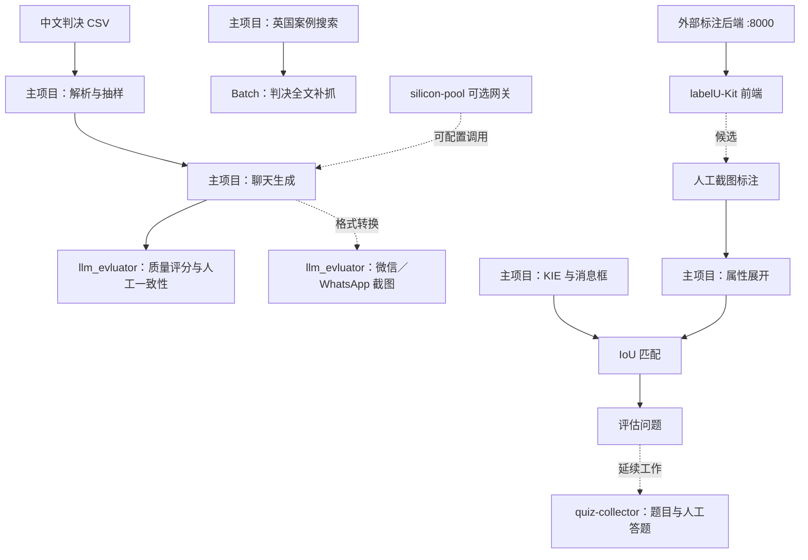

# screenshotLegalHub

本目录集中整理 7 个 ScreenshotLegalBench_v2 关联／候选项目。下面直接给出历史项目架构、环境准备和各项目启动命令；源项目与原报告仍保留在原目录。

## 当前试用入口：v1.1.0 多案工作台

首页改为 [案件库](http://127.0.0.1:18420/)，纳入索引中的315组现有案件材料、1172张图；可搜索、分页查看，并按需生成分析。支持多图拖入和可选案情，自动识别原图并生成单案页面，新增带数字引用和右侧截图栏的真实模型问答。已有单案入口为 [服装付款案](http://127.0.0.1:18420/case?case_id=5ad6f87311be1056f7197a9f)。新增动效、手机布局及减少动态效果支持；中文/English沿用。见 [本轮功能与验收](reports/v1.1.0_multi_case_workspace.md)及 [实际模型评估](reports/v1.1.0_case_qa_evaluation.md)。

下面保留v1.0.0单案历史说明，其测试数、首页描述和“未新增模型调用”仅适用于当时版本。

最新界面为**会话时间轴 / 法律大事记 / 合同内容**三视图：会话有名称分类和筛选，点选原图后在左右两栏核对原文与解释，右栏可切换上下文和条款。支持中文 / English。法律大事记记录8个有原文依据的法律审查节点，合同内容整理8项条款要素；撤回、撤销、反要约未见明确依据时保留“现有材料未见”，不补造事件。48项测试及桌面/手机浏览器检查通过，含两会话测试夹具；见 [当前界面与验收说明](reports/v1.0.0_case_legal_workspace.md)。上一轮说明保留为 [时间轴历史记录](reports/v1.0.0_case_timeline.md)。

工作台首页为 [单案证据理解](http://127.0.0.1:18420/)：服装选购与转款沟通，1个展示会话、6张原图、61条已有真实视觉转录、4个普通事实节点、6项复核解释及8个法律节点。原图仍在 `projects/ScreenshotLegalBench_v2/process_local_evaluator/images/`。查看与检索保存的结果无需再调用模型；旧资料库保留在 `/library`。

此前已真实接通硅基流动 `Qwen/Qwen3.8-27B`，整案生成约168秒；Kimi整案调用因余额不足返回429。本轮沿用助手对照原图与转录的修订版，新增法律节点与双语展示独立归属原文审阅，未新增模型调用。原模型初稿及响应保留；自动语义分析质量仍需迭代。最新单案28次本机检索后端P95约12毫秒、HTTP P95约35毫秒。模型错误及首次修订记录见 [单案历史报告](reports/v1.0.0_one_case.md)。

```powershell
.\.venv\Scripts\python.exe -m legalhub.app serve --port 18420
```

## 当前工作：v2.0.0 数据飞轮

中文全案由扩展入口：[第三轮逐案预览与207种来源标签索引](datasets/v2.0.0/round_003/index.html)、[本轮报告](datasets/v2.0.0/round_003/REPORT.md)、[来源缺口](datasets/v2.0.0/round_003/SOURCE_GAPS.md)、[质量复核清单](datasets/v2.0.0/round_003/QUALITY_REVIEW.md)、[实际迭代方法与修改记录](datasets/v2.0.0/round_003/ITERATION_METHOD.md)。350条历史来源按207种原始标签逐案处理完毕，143份候补独立归档；当前保留177宗候选（含12宗独立候补）、382张860×1864截图、1417条消息，覆盖177种标签，另30种来源不足。三位 Codex agent 全文阅读、直接写作与自审，主 agent 负责修订、渲染和共享检查；模型间复核纠正短句定位及纯图片题的图外信息，撤回一宗未明确发言者的候选。产物独立保存于v2第三轮，不覆盖v1或已认可的第二轮；包含稀疏样本，尚未认证为困难评测集。

最新审阅入口：[第二轮中英文重写与截图对照](datasets/v2.0.0/round_002/index.html)、[实际修改和旧表依据](datasets/v2.0.0/round_002/REPORT.md)。上一轮自然感未达要求；这次直接依据判决重写两案，保留初稿、逐句来源和第二遍修改，不以自动评分宣布质量或难度达标。

按 2026-10-04 最新任务，已完成中英文判决书合成数据第一轮：6 案、190 条消息、49 张固定尺寸预览、24 道候选题。新产物独立保存到 `datasets/v2.0.0/round_001/`；查看 [预览页](datasets/v2.0.0/round_001/index.html)、[本轮报告](datasets/v2.0.0/round_001/REPORT.md)、[流程架构](blocks/synthesizer/README.md)。按中文案由及英文争议类别组织，保留初稿、独立复核、修订稿、来源和具体修正记录。第一轮是待人工审核的开发候选；原文引用及图片/页码/消息映射检查通过，困难度尚未认证。

## v1.0.0 历史基线及剩余工作

2026-10-04 补充：已全文检索归档评估 PDF，找回 GPT-4o/Claude/Gemini 历史运行记录和七份公开 case-study 附件。资产位置、缺口、原稿与模板区别见 [重启核查报告](reports/research/RESTART_FINDINGS.md)；[架构图](docs/architecture.md) 标明 v1 与 v2 的实际状态。新增 [LaTeX 工作区](paper/README.md) 和 [内部评审矩阵](reports/research/REVIEW_AND_REBUTTAL.md)。共享目录已有真实模型试测、扩大复测及代码检索与抽取闭环；全量比较、专业评分和完整法律工作流仍待完成，当前稿件不能作为已完成实验论文提交。

按顺序完成：**现有图片/评估集实跑模型并产出 Markdown 报告 → 用评测选出的模型实现 retrieve 与证据理解 → 成功启动并验收软件**。

图片主目录是 `projects/ScreenshotLegalBench_v2/process_local_evaluator/images/`（1,088 张）。`projects/quiz-collector/images/` 补齐另外 82 张；合并索引有 **1,170 个原图文件 ID**，内容摘要去重为 1,168 种，评测题引用均可解析。完整核验见 [资产报告](reports/restart/ASSET_RESTART.md)，重复明细见 [当前覆盖快照](reports/v1.0.0_retrieval_coverage.json)，模块架构图、GitHub/论文版本对账及剩余缺口见 [重启架构说明](docs/RESTART_ARCHITECTURE.md)。

借鉴 [LegoFlow](https://github.com/LegoX/LegoFlow) 的 block 配置和产物结构，复用旧代码建立资产、评测、证据理解、检索和报告模块。资产和评测入口已跑通；检索按用户要求与评测同步开发，由代码完成查询。模型只做证据理解与结构化抽取。[模型评测报告](reports/v1.0.0_model_evaluation.md) 已包含首轮真实视觉 API 对照，尚未完成全量评测或确定最佳模型。

历史技术版：[全部资料库](http://127.0.0.1:18420/library)。支持关键词/人物/事件/日期检索、原图引用区域、同图上下文、类案和法条原文检索、事件大事记、CSV/JSON 导出及截图导入。当时通过真实上传→模型抽取→代码检索→原图引用→导出验收和30项测试，但用户试用表明整案法律理解与操作流程不足，不能据此认定完整可用。其抽取默认Kimi K3 low，本轮发现余额不足；当前首页以顶部单案入口和报告为准。历史说明见 [软件技术验收报告](reports/v1.0.0_software_iteration.md)及 [检索模块](blocks/retriever/README.md)。

```powershell
.\.venv\Scripts\python.exe -m legalhub.app serve --port 18420
```

第二轮修订评测：`tools/iterate_v1_p3.py`。P2 中 evidence 定义偏离原“规范截图形式”问题，已停止且保留记录；P3 按原题修正，开发集先核验适配，再运行 200 张截图和 30 个多图案由任务。未改输入和配置的案由结果带来源摘要复用。私有项目链接不传给模型、其它 agent 或写入报告。

P3 已完成三个配置各 230 项，见 [结果分析与改进顺序](reports/v1.0.0_iteration_analysis.md)和 [分项指标](reports/v1.0.0_iteration_p3_holdout_structured.md)。三配置证据形式判断均未超过多数类基线，历史跨字段标签冲突也已列入审核队列；当前软件不据此自动筛除证据。GPT-6.1 Sol 待有效凭据补测。

在仓库根目录可复跑离线流程：

```powershell
.\.venv\Scripts\python.exe tools/restart_inventory.py
.\.venv\Scripts\python.exe -m legalhub.benchmark prepare
.\.venv\Scripts\python.exe -m legalhub.benchmark check
.\.venv\Scripts\python.exe tools/write_v1_readiness.py
```

真实推理使用 `configs/models.local.yaml` 中核实过的视觉模型。统一入口 `run` 不带 `--execute` 只检查模型与题量；带该参数才发送图片和问题。当前已经进行 24 题共同样本的真实视觉 API 对照，结果见上方评测报告。

本轮对照可断点继续（以下 pilot 命令会真实调用模型）：

```powershell
.\.venv\Scripts\python.exe tools/run_vision_pilot.py run
.\.venv\Scripts\python.exe tools/report_vision_pilot.py
```

脚本对每个配置最多运行共同样本的 24 题，已有记录的题目不会自动重发；原始失败保留。私有项目链接和密钥不写入评测请求或报告。

项目重启的目标架构、判决书双语合成数据方案、旧资料核验结果与分阶段开发计划见 [PROJECT_RESTART_BLUEPRINT.md](PROJECT_RESTART_BLUEPRINT.md)。当前按非破坏性重构推进：旧实验目录作为历史基线保留，新流程通过统一 Schema 和 adapters 逐步接入。

## 1. 项目架构

```text
screenshotLegalHub/
├── projects/
│   ├── ScreenshotLegalBench_v2/ 主实验：判决处理、聊天生成、KIE 与评估问题
│   ├── llm_evluator/            质量评分、人工一致性和截图自动化
│   ├── Batch/                   英国判决全文补抓
│   ├── labelU-Kit/              标注前端与组件（候选）
│   ├── silicon-pool/            模型 API 网关（候选）
│   ├── crawler-law/             旧法律数据采集（候选）
│   └── quiz-collector/          12 月后续题目与人工答题
├── reports/ScreenshotLegalBench_v2/ 报告和检索证据
├── hub_paths.py                副本跨项目路径解析
├── tools/                      迁移及文档工具
├── migration_manifest.json     复制范围与文件变更记录
├── verification.json           迁移时的哈希与语法核验
└── readme_verification.json    本次 README 文档核验
```



实线表示已确认的代码／数据关联；虚线表示候选或需要转换的衔接。这些是独立脚本和服务，**无需一次启动全部项目**。

## 2. 按用途选择运行顺序

| 要做的工作 | 执行顺序 | 外部条件 |
| --- | --- | --- |
| 中文聊天生成 | 主项目抽样 → batch_infer_v2.py → llm_evluator 评分 | 模型配置与可用 API；评分需人工表 |
| 英国案例全文 | 主项目 uk_crawaler/main.py → detail.py → Batch/england_case_caller.py | 网络与案例网站 |
| 截图生成 | 准备 chatList JSON／WhatsApp JSONL → llm_evluator 截图脚本 | Playwright Chromium、生成页面 |
| 标注平台 | 准备外部标注后端 :8000 → LabelU 前端 :3004 | 该 Hub 没有标注后端 |
| 截图结构化评估 | 属性展开 → KIE 推理 → IoU 匹配 → 问题导出 v2 | 匹配的图片、标注版本和模型配置 |
| 人工答题与统计 | quiz-collector/generator.py → app.py :5000；另开 dashboard.py :5001 | 已有任务数据与图片 |
| 可选 API 网关 | silicon-pool → 手动配置调用方 base_url | API Key、网关认证配置 |

## 3. 环境和服务地址

Python 项目使用各自的 `.venv`；本文按 Windows PowerShell 和 Python 3.12 编写，需先安装对应解释器。LabelU 需要 Node.js 与兼容现有 v9 锁文件的 pnpm。模型推理、网站采集和人工 Web 服务的运行前提分别写在下方。

先在 PowerShell 定义 Hub 路径（如果移动目录，修改这一行）：

```powershell
$HubRoot = 'D:\workspace\screenshotLegalHub'
```

| 服务 | 地址 | 状态／依赖 |
| --- | --- | --- |
| 评分服务 | http://127.0.0.1:18321；/health、/docs | 模型与飞书配置 |
| LabelU 开发前端 | http://localhost:3004 | 外部标注后端 8000 |
| LabelU 静态预览 | http://localhost:3007 | 先构建，部署需后端路由 |
| API 网关：本地 Python | http://127.0.0.1:7898/v1 | 可选 |
| API 网关：Docker | http://localhost:17898/v1 | 可选，容器内部 7898 |
| 人工答题 | http://127.0.0.1:5000 | quiz-collector 数据 |
| 答题统计 | http://127.0.0.1:5001 | 同一 data 目录 |

下方每个项目都给出安装和启动命令。命令会在副本目录运行；模型调用、采集和评分会产生输出，评分工作流可能写回飞书。

## 4. ScreenshotLegalBench_v2

主数据构建与截图理解实验。输入为判决 CSV 和人工标注；输出为聊天生成结果、消息框与问题级评估数据。聊天质量评分由相邻 llm_evluator 承担。

```text
generate_chat/             判决 CSV → 案由抽样 → 聊天生成
uk_crawaler/               英国案例搜索、详情补充
case_search_results/       英国案例数据
process_local_evaluator/   人工属性展开、KIE、IoU、问题导出
screenshot_legal_annotations.json  人工标注的一个版本
describe_data_0811freeze.py        分类与属性统计
generate_wechat_shot.py           Pillow 截图原型
```

先进入项目目录：

```powershell
Set-Location (Join-Path $HubRoot "projects/ScreenshotLegalBench_v2")
```

作用：主数据构建与评估脚本集；没有统一 Web 服务。

先进入 `screenshotLegalHub/projects/ScreenshotLegalBench_v2`。副本中的已识别旧 Windows／Linux 项目路径已改为从 Hub 根目录定位，原始项目未修改。

### 环境准备（PowerShell）

在本项目目录执行：

```powershell
py -3.12 -m venv .venv
.\.venv\Scripts\python.exe -m pip install -r requirements-hub.txt
```

`requirements-hub.txt` 根据当前代码 import 整理，是启动依赖清单，不是原实验版本锁定文件。下方命令都使用本项目虚拟环境；不用激活环境。

### 本地数据处理

这些脚本会重新写出解析或统计产物：

```powershell
.\.venv\Scripts\python.exe describe_data_0811freeze.py
.\.venv\Scripts\python.exe generate_chat/generate_chat_sample.py
```

进入评估子目录再执行标注展开与现有结果匹配：

```powershell
Push-Location process_local_evaluator
..\.venv\Scripts\python.exe 0_generate_evaluate_qa.py
..\.venv\Scripts\python.exe 2_match_iou.py
..\.venv\Scripts\python.exe 2_match_iou_v2.py
Pop-Location
```

`0_generate_evaluate_qa.py` 读取当前子目录的 `screenshot_legal_annotations (1).json`；统计脚本读取根目录另一个标注版本。二者不能混用为同一冻结版本。`2_match_iou_v1.py` 有函数名不一致，问题导出使用 v2。

### 聊天生成与 KIE 推理

先在 `generate_chat/config_full.yaml`、`process_local_evaluator/config.yaml` 核对模型别名、模型名、API Key 与服务地址，再执行：

```powershell
.\.venv\Scripts\python.exe generate_chat/batch_infer_v2.py
Push-Location process_local_evaluator
..\.venv\Scripts\python.exe 1_run_infer_kie_gt.py --config config.yaml --models qwen2_5_vl_32b --prompt-file kie_prompt.md --images-dir images --output-dir output --funnel-iterations 0
Pop-Location
```

上述命令会调用模型。KIE 的 `images` 输入目录已随项目复制；运行前核对其截图范围与所选标注版本是否一致。`batch_infer_v2.py` 默认提示词是 `prompt_v0.md`；需要 v1 时应修改其 `PROMPT_MD_PATH`，并单独命名结果，避免覆盖历史产物。

### 英国案例采集

```powershell
.\.venv\Scripts\python.exe uk_crawaler/main.py
.\.venv\Scripts\python.exe uk_crawaler/detail.py
```

从项目根目录运行，这样 `case_search_results` 相对目录一致。这两条命令访问案例网站并写出采集结果。

### 截图原型

`generate_wechat_shot.py` 使用 Pillow，运行前需设置实际中文字体 `FONT_PATH`。更完整的浏览器截图脚本见相邻 `llm_evluator/启动说明.md`。本次仅复制并校验图片资源，没有查看或解析图片内容。

## 5. llm_evluator

质量评分、人工一致性分析及截图自动化。服务读取人工评分表和候选聊天，调用模型评分，输出本地结果并按现存工作流写回飞书；截图生成是独立脚本，不由评分服务自动触发。

```text
main_v3_rpm.py / main_v3.py  FastAPI 评分服务
feishu_event_sync.py         事件接收与任务队列
feishu_utils.py              飞书记录、附件与通知
input/                      评分输入
_merged/                    人工评分合并表和评分输出
fmt_re_test*.py              相关性、排序与校准分析
wechat_screenthot/           Playwright 微信截图
whatsapp_screentshot/        Playwright WhatsApp 截图
```

先进入项目目录：

```powershell
Set-Location (Join-Path $HubRoot "projects/llm_evluator")
```

作用：多模型生成质量评分、人工／模型一致性分析，以及微信与 WhatsApp 截图自动化。进入 `screenshotLegalHub/projects/llm_evluator`。

### 环境准备（PowerShell）

在本项目目录执行：

```powershell
py -3.12 -m venv .venv
.\.venv\Scripts\python.exe -m pip install -r requirements-hub.txt
```

`requirements-hub.txt` 根据当前代码 import 整理，是启动依赖清单，不是原实验版本锁定文件。下方命令都使用本项目虚拟环境；不用激活环境。

### 评分服务

推荐入口是带 RPM 控制的 `main_v3_rpm.py`；兼容入口为 `main_v3.py`。在 `config.yaml` 核对模型配置，在 `feishu_utils.py` 核对现存飞书配置。代码没有自动加载 `.env`；需要该文件的环境变量时使用下面的 dotenv 启动方式：

```powershell
.\.venv\Scripts\python.exe -m dotenv run -- .\.venv\Scripts\python.exe -m uvicorn main_v3_rpm:app --host 127.0.0.1 --port 18321
```

若不需要 `.env`，可直接：

```powershell
.\.venv\Scripts\python.exe -m uvicorn main_v3_rpm:app --host 127.0.0.1 --port 18321
```

健康检查 `http://127.0.0.1:18321/health`，接口说明 `http://127.0.0.1:18321/docs`，任务入口 `POST /run`。启动时会建立事件工作队列；实际评分任务会调用模型，并按原代码向飞书上传或通知。

主要输入为 `_merged/human_merged.xlsx`。`input/wkinfo_samples_with_inference.jsonl` 当前只有 `key/idx/ts/response`，缺少判决映射字段；模型评分将依赖合并表 `content` 回退。正式运行前应核对正文及人工评分列；迁移没有伪造这些缺失字段。

### 分析脚本

```powershell
.\.venv\Scripts\python.exe human_score_spearman_count.py
.\.venv\Scripts\python.exe fmt_re_test_v1.py --merged-xlsx _merged/human_merged.xlsx --scored-csv _merged/你的评分结果.scored.csv --out-prefix _merged/hub_analysis
```

替换 `你的评分结果.scored.csv` 为实际文件。前者统计人工分的并列／可区分分布；后者分析排序一致性。`fmt_re_test.py` 是带交叉验证校准的旧实验分析版本。

### 微信截图

```powershell
.\.venv\Scripts\python.exe -m playwright install chromium
.\.venv\Scripts\python.exe wechat_screenthot/generate_chat_screenshots_v6.py --input-root datasets --output-root output_screenshots
```

先准备 `datasets/<会话>/chat.json`，采用 `vue3-wechat-tool` 的 `chatList` 格式；当前默认 `datasets` 目录不存在。浏览器会访问在线生成器，也可通过 `--url` 指向自建实例。

### WhatsApp 截图

```powershell
.\.venv\Scripts\python.exe whatsapp_screentshot/fake_whatsapp_chat.py --jsonl_path 路径/会话.jsonl --headless
```

输入每条必须有 `timestamp/content/role`。生成器输入与主项目 `participants/messages` JSON 不同，需自行准备正确格式。Playwright 浏览器需要按上面的命令安装。

## 6. Batch

英国案例全文富集；另保留通用批处理历史代码。已确认关联的是 480 条英国案例及正文补抓，输入来自主项目 uk_crawaler 的数据；其他历史脚本不是这一流程的必需服务。

```text
england_case_caller.py       读取案例链接、补抓全文、修复缺失正文
england_court_dataset/      原始及 enriched JSONL
requirements-hub.txt        英国案例流程的启动依赖
其他 *_caller / *_processor 通用历史模型与上传脚本
```

先进入项目目录：

```powershell
Set-Location (Join-Path $HubRoot "projects/Batch")
```

本 Hub 明确关联的部分是英国判例正文补抓。完整 Batch 源文件也已复制，以保留上下文；其他通用 Google／Gemini 脚本不属于已确认论文链路。

进入 `screenshotLegalHub/projects/Batch`。

### 环境准备（PowerShell）

在本项目目录执行：

```powershell
py -3.12 -m venv .venv
.\.venv\Scripts\python.exe -m pip install -r requirements-hub.txt
```

`requirements-hub.txt` 根据当前代码 import 整理，是启动依赖清单，不是原实验版本锁定文件。下方命令都使用本项目虚拟环境；不用激活环境。

### 英国判例正文补抓

```powershell
.\.venv\Scripts\python.exe england_case_caller.py
```

默认输入已定位到本 Hub 的 `england_court_dataset/results.jsonl`。当前 `FIX_ENRICHED_PATH` 指向已有 `results.enriched.jsonl`，因此默认是扫描已有富集结果、修复缺失正文；程序可能覆盖副本中的富集文件并产生备份。需要完整新抓取时，在本项目副本中将 `FIX_ENRICHED_PATH` 设为 `None`，同时核对 `OVERWRITE_INPUT`。

原始与富集文件均有 480 条记录。命令访问案例网站；不会修改原目录中的同名文件。

### 其他历史脚本

原 `requirements.txt` 为旧 Google Vision 工具依赖。这里新增的 `requirements-hub.txt` 只面向已确认关联的英国案例流程，避免把所有旧 Google 依赖当作此流程的启动条件。其他历史服务另需其云端账号、模型配置与对应依赖，不作为统一推荐入口。

部分通用上传／Gemini 脚本还保留 Spider_XHS 的原数据路径，它不属于本次确认关联项目。使用这些历史脚本时需另设输入目录；具体文件见 Hub 根目录 path_audit.json。

## 7. labelU-Kit

人工标注前端与组件库，具体论文部署待确认。这里只有前端和标注组件，完整任务平台还需要独立标注后端。它与主项目标注格式兼容，但数据来源没有直接确认。

```text
apps/frontend/              标注任务前端（Vite / React）
apps/frontend/vite.config.ts /api 与 /ws → 外部 8000 端口
packages/                   图像、音视频、格式转换和 React 组件
pnpm-workspace.yaml         pnpm 工作区
pnpm-lock.yaml              前端依赖锁文件
```

先进入项目目录：

```powershell
Set-Location (Join-Path $HubRoot "projects/labelU-Kit")
```

作用：图像、视频和音频标注组件及前端任务平台。它是报告中的标注工具候选；具体数据来源仍待确认。

进入 `screenshotLegalHub/projects/labelU-Kit`，安装 Node.js 与 pnpm；当前锁文件为 v9 格式，使用兼容该格式的 pnpm。锁文件已保留，`node_modules`、构建产物与 `.git` 未复制。

### 前端开发服务（PowerShell）

```powershell
$env:HUSKY = '0'
pnpm install --frozen-lockfile
pnpm --filter @labelu/frontend start
```

`HUSKY=0` 适用于没有复制 Git 仓库的源代码快照，避免 prepare 安装 Git hooks。根目录没有通用 `start` 脚本，因此需使用 `@labelu/frontend` 过滤器。前端地址：`http://localhost:3004`。

### 后端依赖

`apps/frontend/vite.config.ts` 将 `/api` 代理到 `http://127.0.0.1:8000`，`/ws` 代理到同端口。当前目录包含前端及组件，没有配套标注后台服务。前端可启动，但任务、账号、数据和导出等完整功能需要另外配置后端；或按实际部署修改代理地址。

本地源文件保留了隐藏部分导出、任务配置、删除和下载按钮的改动，迁移不会恢复这些历史改动。

### 构建与预览

```powershell
pnpm build
pnpm build:frontend
pnpm --filter @labelu/frontend preview
```

预览端口为 3007；静态预览的后端路由需要部署环境另行提供，Vite 开发代理不等于生产后端配置。启动依赖来自现存 package.json 和锁文件，迁移没有执行依赖安装或构建。

## 8. silicon-pool

模型 API Key 管理与转发候选。调用方可以把模型 base_url 指向本服务，但目前实验配置仍是直接服务商地址；无需为所有实验先启动网关。

```text
main.py                    FastAPI 主入口（7898）
routers/                   管理和模型代理路由
config.py / db.py          当前工作目录下的配置与数据库
static/                    管理界面
Dockerfile                 Python 容器构建
 docker-compose.yml        宿主机 17898 → 容器 7898
```

先进入项目目录：

```powershell
Set-Location (Join-Path $HubRoot "projects/silicon-pool")
```

作用：硅基流动 API Key 管理与兼容接口转发。报告中的基础设施候选；未确认原实验实际使用此网关。

进入 `screenshotLegalHub/projects/silicon-pool`。

### Python 本地启动

`pyproject.toml` 指定 Python >=3.12。

```powershell
py -3.12 -m venv .venv
.\.venv\Scripts\python.exe -m pip install -r requirements.txt
.\.venv\Scripts\python.exe main.py
```

管理页面：`http://127.0.0.1:7898`，API 地址：`http://127.0.0.1:7898/v1`。首次启动会在当前目录生成配置／数据库，沿用项目原有默认账号配置。需要供其他项目调用时，再修改其模型 `base_url` 与认证配置；迁移没有自动切换网关。

### Docker Compose

```powershell
docker compose up --build -d
```

副本 `docker-compose.yml` 的源码挂载已从 `D:/silicon-pool:/app` 调整为 `.:/app`。当前端口映射为 `17898:7898`，因此 Docker 模式页面是 `http://localhost:17898`，API 为 `http://localhost:17898/v1`。

停止：`docker compose down`。原始 Compose 文件未修改。

## 9. crawler-law

旧法律／判决数据采集候选。依赖目标网站登录和外部数据库。wkxx.py 默认采集法律条文，不是判决；如需判决，需修改副本的入口。

```text
wkxx.py                    wkinfo API 分页采集
faxin*.py                  法信采集流程
crawler.py / task_scheduler.py 浏览器采集与任务调度
config.py                  外部数据库配置
crawler.ddl                历史数据库结构
chromedriver-win64/        旧浏览器驱动资源
```

先进入项目目录：

```powershell
Set-Location (Join-Path $HubRoot "projects/crawler-law")
```

作用：2023—2024 年的中国法律与判决数据采集；与主项目 wkinfo 数据来源相关，但尚未确认直接产物衔接。进入 `screenshotLegalHub/projects/crawler-law`。

### 环境准备（PowerShell）

在本项目目录执行：

```powershell
py -3.12 -m venv .venv
.\.venv\Scripts\python.exe -m pip install -r requirements-hub.txt
```

`requirements-hub.txt` 根据当前代码 import 整理，是启动依赖清单，不是原实验版本锁定文件。下方命令都使用本项目虚拟环境；不用激活环境。

### wkinfo 采集

运行前先核对：

- `config.py` 的 MySQL／MongoDB 连接与数据库名；外部数据库及数据表需已准备好。
- `crawler.ddl` 的结构是否与目标数据库一致。
- `wkxx.py` 内现存会话凭证是否仍有效；本说明不展示其内容。
- `wkxx.py` 最后几行的实际采集入口。

当前默认执行的是 **法律数据分页采集，从第 21 页开始**，不是判决采集：

```powershell
.\.venv\Scripts\python.exe wkxx.py
```

需要判决采集时，在新目录副本中将最后的 `fetch_law_paginated_results(21)` 改为已有的 `fetch_judgment_paginated_results(1)`，同时核对表和查询参数。代码会访问远程网站并写入所配置数据库。

### 法信与浏览器采集

`faxin*.py`、`crawler.py`、`task_scheduler.py` 属于其他历史采集路径，依赖目标网站登录、Chrome／驱动和数据库。复制的旧 Windows 驱动可作历史资源，但并不代表与现有浏览器兼容。先按所选脚本调整数据库、登录和驱动，再单独运行；没有可无配置启动的统一服务。

## 10. quiz-collector

后续题目构建与人工答题（2025 年 12 月）。题目生成、人工答题、统计面板和模型评估是可分别运行的入口；统计面板使用 5001 端口，以免与答题界面的 5000 冲突。

```text
app.py                     Flask 人工答题／标注界面
 dashboard.py              Flask 统计面板
generator.py               单图题、排序题、多选题组合
0_extract_case_of_action.py 案由与模型干扰项
1_gen_psedo_wrong.py        错误选项补充
eval_modelrefine.py         模型回答补充
quality_assuarance_evaluate.py 聊天质量评分
data/ / images/            任务、答题记录与图片资源
```

先进入项目目录：

```powershell
Set-Location (Join-Path $HubRoot "projects/quiz-collector")
```

作用：2025 年 12 月的关联延续项目，包含题目生成、人工答题／标注、统计面板及模型评估。进入 `screenshotLegalHub/projects/quiz-collector`。

### 环境准备（PowerShell）

在本项目目录执行：

```powershell
py -3.12 -m venv .venv
.\.venv\Scripts\python.exe -m pip install -r requirements-hub.txt
```

`requirements-hub.txt` 根据当前代码 import 整理，是启动依赖清单，不是原实验版本锁定文件。下方命令都使用本项目虚拟环境；不用激活环境。

### 人工答题／标注界面

已有 `data` 和 `images` 随项目复制。先核对 `data/admin.jsonl` 是否是目标基准，再运行：

```powershell
.\.venv\Scripts\python.exe app.py --file data/admin.jsonl --img_dir images --port 5000
```

页面：`http://127.0.0.1:5000`。代码会在副本的 `data` 中创建或更新用户答题数据；账号沿用 `app.py` 的现存配置。本次没有启动服务或触碰原答题数据。

### 统计面板

另开终端，同一项目目录运行：

```powershell
.\.venv\Scripts\python.exe dashboard.py --data-dir data --host 127.0.0.1 --port 5001
```

面板：`http://127.0.0.1:5001`。两个服务原默认都用 5000，这里明确分配 5001 避免冲突。

### 题目生成

```powershell
.\.venv\Scripts\python.exe generator.py
```

读取 `source.json`、`group_source.json`、`multi_choice_source.json`，写出 `data/final_tasks.jsonl`。这会重新生成任务文件，先确认要使用当前输入。

`0_extract_case_of_action.py` 通过模型生成案由和干扰项；`1_gen_psedo_wrong.py` 增补伪错误选项。它们需要指定实际输入／输出和配置，可用 `--help` 查看参数。

### 模型评估的缺失输入

`quality_assuarance_evaluate.py` 的默认评分 Markdown 当前缺失；`eval_modelrefine.py` 默认的 `v2_eval_modelrefine` 问答表也未保存在主项目中。应补齐后再运行，例如：

```powershell
.\.venv\Scripts\python.exe quality_assuarance_evaluate.py --score-md 你的评分提示词.md --config config_full.yaml --in-jsonl ../llm_evluator/input/wkinfo_samples_with_inference.jsonl --in-xlsx ../ScreenshotLegalBench_v2/generate_chat/output/wkinfo_samples_by_case.xlsx
.\.venv\Scripts\python.exe eval_modelrefine.py --input-xlsx 你的问答表.xlsx --out-xlsx 检查后的回答.xlsx --config config_full.yaml --layout-json layout_vqa_case_text_only_merged.json --struct-json ../ScreenshotLegalBench_v2/process_local_evaluator/image_structured_info.json
```

先替换占位文件，核对该配置里实际模型别名并传入 `--model`／`--model-alias`。以上评估会调用外部模型；复制并不能补齐未保存的历史输入。

## 11. 报告、迁移范围和未完成的运行验证

- [项目对应关系报告](./reports/ScreenshotLegalBench_v2/项目对应关系说明.md)
- [工作区项目筛查](./reports/ScreenshotLegalBench_v2/工作区项目筛查.csv)
- [相关代码日期清单](./reports/ScreenshotLegalBench_v2/相关项目代码日期清单.csv)
- [迁移清单](./migration_manifest.json)、[迁移核验](./verification.json)、[路径审计](./path_audit.json)

代码、配置、已有数据和图片资源已复制。Git、node_modules、虚拟环境、缓存和构建目录没有复制；源目录中的这些内容仍然保留。代码中的已识别关联项目路径由 hub_paths.py 定位，历史数据内的原路径保留作为来源记录。

已有迁移核验覆盖 8,031 个源文件和副本的哈希、84 个 Python 文件语法；后续 README 编辑单独记录在 readme_verification.json。没有安装依赖或启动以上服务，因此这些命令是依据实际入口整理的启动说明，尚未做完整运行验收。

尚缺的输入包括 llm_evluator/datasets、主项目评分提示词 scoring_prompt_v3.md 与 v2_eval_modelrefine 问答表；LabelU 后端和爬虫数据库也需另行提供。Batch 通用历史脚本仍引用范围外 Spider_XHS 数据，详见路径审计；其英国案例流程已适配。

报告目录中的旧检索脚本属于历史归档，仍可能引用原工作区，不用作 Hub 的启动入口。
