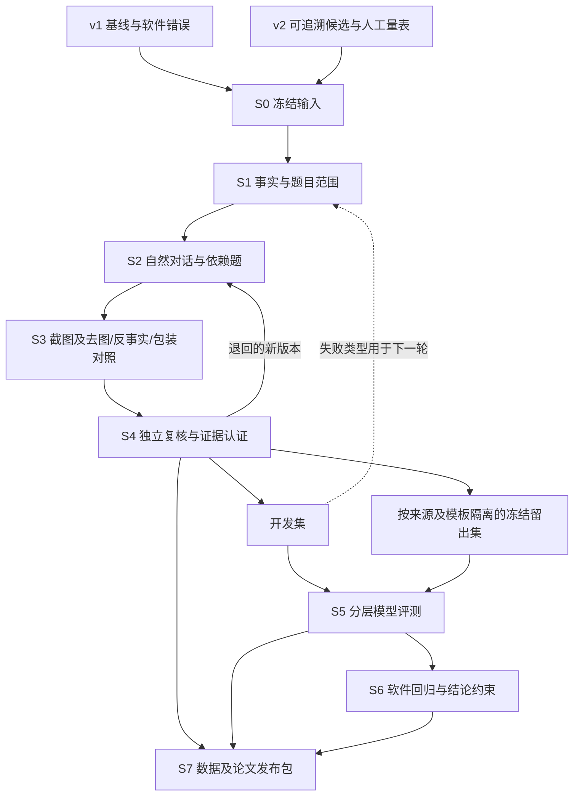

# v3.0.0 改进与优化计划

> 2026-10-23 状态对账：[完成度](docs/ai_docs_center/PROGRESS.md) · [人工交接](docs/v3.0.0/CALIBRATION_HANDOFF.md)。当前四场景范围S0–S3作者/机械阶段交接完成（4/8），S4独立认证0题，未达发布条件。T03–T06与I11导入修复已执行；[后续计划](docs/ai_docs_center/NEXT_STEPS.md)。下文为2026-10-04计划基线，当前执行状态独立记账。

计划版本：1.0；整理日期：2026-10-04。状态：执行方案，尚未启动 v3 批量生成、正式评测或发布。

v3.0.0 的目标是交付一套**可复核证据依赖、区分中间判断与法律结论、能反哺证据理解软件的数据与评测流程**。本计划明确各阶段的输入、输出、启动条件和验收条件；结构化工作清单见 [work_packages.json](docs/v3.0.0/work_packages.json)，日常检查入口见 [准备与交接清单](docs/v3.0.0/READINESS.md)。

## 1. 版本边界及衔接

|版本|主要职责|交给下一版的内容|
|---|---|---|
|v1.0.0|已有图片与评估集的模型实测；证据理解、代码检索、来源定位及软件运行|冻结的基线数据、真实响应、分项错误、可运行软件版本和未完成事项|
|v2.0.0|检查旧图/题质量；根据判决迭代聊天和评分 prompt；生成自然、可追溯的微信/WhatsApp 截图|经过来源与自然度审核的候选案件、消息、截图、问题、人工量表与生成记录|
|v3.0.0|认证证据依赖和最小充分集；去图/反事实/包装对照；分层评测；将缺证与结论一致性约束接入软件|认证状态明确的数据版本、评测报告、软件回归集和论文实验包|

旧架构文件中提到的“v2 最小证据集合/难度验证”，按本计划理解为候选设计；系统化认证与对照评测归入 v3。此前 `datasets/v2.0.0/dependency_pilot_001_r1/` 保留原路径与开发属性，作为 v3 方法预研资产引用，不移动或改名成已发布的 v3 数据。

v1 的全量专业评测、完整双模式、专用 Excel 和时间轴 PPT 尚有未完成事项，仍属于原始交付责任。v3 计划不将它们改写成已完成，也不把已有 CSV/JSON 等同于专用 Excel。v3 数据准备可以先行；软件集成阶段需要可复现的 v1/v2 软件快照。

## 2. 输入资产及目前准备程度

以下是本次核查的可复用入口，不是对正在变化的共享工作区作持续状态保证。

|输入|现有入口|可用程度/缺口|使用方式|
|---|---|---|---|
|旧图、旧题及 v1 评测|[v1 评测报告](reports/v1.0.0_model_evaluation.md)、[原数据契约](docs/data-contracts.md)|已有真实运行；历史答案与专业正确性不能直接等同|冻结原始版本，建立修订旁注与错误分类|
|当前软件|[单案报告](reports/v1.0.0_one_case.md)|单案理解、检索、来源定位可复用；语义质量和双模式仍需完善|保存运行配置、原始模型输出、助手修订及软件基线|
|v2 判决约束生成样本|[第二轮](datasets/v2.0.0/round_002/REPORT.md)、[第三轮](datasets/v2.0.0/round_003/REPORT.md)|可作为候选池；批量覆盖与审核仍在推进|按每个案件的实际审核状态导入，不等候全部案由生成才启动小批准备|
|历史多维人工评分|`归档.zip` 及 v2 已整理的旧表依据|归档存在；v3 使用前须固定具体表、sheet、行 ID、维度及缺失情况|建立量表快照和新旧字段对照，不直接把旧分数用作多跳认证|
|受控依赖预研|[12 场景报告](reports/research/legal_answer_review/20261004_dependency_pilot_v1/RESULTS.md)|48 个图片位置、18 种像素内容；两种语言共用一个抽象模板；只有开发性结论|验证工具、校准复核流程；全部归入开发集|
|盲审与汇总工具|[既有认证方案](reports/research/legal_answer_review/20261004_dependency_certification_v1/CERTIFICATION_PLAN.md)|两份空白盲审包及汇总工具可用；没有专业审核完成记录|改为 v3 案件/问题版本后生成新包|
|模型接入|`configs/models.local.yaml`、`legalhub/benchmark.py`|已有云端适配；可用性、余额、实际返回模型需运行前探测；本地需服务就绪|保留 `cloud/local` 开关，不以曾经可用代替本次可用|
|论文与评审材料|[LaTeX 工作区](paper/README.md)、[评审矩阵](reports/research/REVIEW_AND_REBUTTAL.md)|工作稿可用；原提交稿、完整评审/rebuttal 的缺口以清单为准|另建 v3 稿件与结果引用，不覆盖原稿|

## 3. 必须先固定的研究口径

1. **证据范围**：只看截图，还是允许案件身份背景、特定法条或检索结果；该边界写进题目协议。图像共同提交不能自动成为同一主体、订单或会话的证明。
2. **时间范围**：区分历史履行是否满足条件、当前是否具备未来履行条件。分别记录消息日期、消息中提到的事件日期、相对时间和推定时间；分钟级合成排版时间不能作为真实时序事实。
3. **答案层级**：事实抽取、身份/事项对齐、条件判断、意思表示与法律结论分别评分。区分“未证明满足”和“已经证明不满足”。
4. **法律范围**：中文、英文是语言字段；法域、适用规则及生效时间另存。英文 WhatsApp 题不自动适用英国法。法律后果题必须准备规则来源与专业复核；单纯约定条件题只评价其限定范围。
5. **来源性质**：真实授权截图、判决原话、判决事实转述、附件重建、合成补充、完全虚构及反事实分别标记。反事实与原始判决事实保留父子关系，不能作为新的真实事实。
6. **数据隔离**：同判决、同源截图、近似改写、同一生成模板及其反事实归入同一划分。已用于修题/调 prompt 的实例不能进入新留出集。

## 4. 分阶段输入、输出和启动条件

以下 S0–S7 对应结构化工作清单。表中“输出”均是 v3 计划产物，不能仅因路径被列出就认为已经存在。

|阶段|明确输入|明确输出|启动前必须具备|完成/交接条件|
|---|---|---|---|---|
|S0 资产与基线冻结|v1 运行、v2 候选、旧评分、软件快照、预研结果|`source_manifest.jsonl`、`baseline_snapshot.json`、`readiness.json`、问题清单|资产可读，能区分版本/作者/来源；为新产物分配目录|每个纳入输入有路径、哈希、来源、状态；缺口有归属及影响阶段；无覆盖历史材料|
|S1 事实与评审口径|S0 清单、候选判决/聊天、历史量表|`case_scope.json`、`fact_ledger.jsonl`、`rubric.json`、量表映射、分层抽样方案|明确法域、证据范围、任务类型；能取得来源原文；审核角色安排可记录|关键原文可定位，未知项保留；事实陈述与真实发生分开；历史量表与新维度定义不冲突|
|S2 依赖题与自然对话设计|S1 事实账本及范围、自然度合格的 v2 样本|候选 `messages.jsonl`、`questions.jsonl`、`dependency_graphs.jsonl`、作者答案、替代解释|每题有可核查目标；确定哪些前提必要、哪些不适用；合成补充可辨认|无题干泄漏必要身份/答案；前提充分或缺证有意设计；逻辑连贯；作者自审和自然度检查通过|
|S3 渲染与控制实验材料|S2 候选、固定渲染器及配置|截图、HTML、区域映射、全部子集清单、反事实/分页/干扰对照、机械检查报告|生成源码、字体/浏览器/视口可固定；每个干预有明确目标|引用及区域可解析；原图不改；干预语义一致；不存在意外条件变更或裁切丢失|
|S4 独立复核与证据认证|S3 冻结材料、问题范围、量表、盲审包|两份独立意见、分歧记录、裁决、认证记录、退回修改清单|每题两位独立复核者；必要时第三人裁决；法律后果题有对应法域能力|歧义已处理；逐题说明充分性/最小性/反证；认证粒度和穷尽范围明确；未通过题不能冒充金标|
|S5 冻结评测与难度分析|S4 合格题、冻结划分、模型清单、预算和评分协议|`run_spec.json`、原始响应、逐节点复核、分项指标、去图/反事实报告、难度描述|API/本地服务可用；预算与重试规则已配置；模型/提示词/评分器版本冻结|计划分母完整；失败单列；引用/中间判断/结论独立报告；基线、重复性和不确定性齐备|
|S6 软件约束与回归|S4/S5 错误集、可复现软件基线、原数据契约|跨会话与事件来源链、缺证与结论一致性检查、双模式回归结果、导出兼容报告|来源定位和代码检索基线能运行；模式/委托方/页码定义清楚|未证实的必要前提不被默认为成立；合法替代支持路径可用；界面及导出保留来源与审核状态|
|S7 版本发布与论文实验包|S4 认证数据、S5 结果、S6 验收、来源/许可记录|版本清单、数据说明、模型评测 MD、软件交付说明、LaTeX 表图及局限说明|每条发布声明有证据；发布范围明确；研究与软件所需检查均完成|按下文发布门槛逐项验收；未完成项目显式列出，不以计划代替结果|

## 5. 阶段间的数据契约

扩展现有 [数据契约](docs/data-contracts.md)，采用新版本转换器，不直接覆盖旧 JSON。

|对象|必要字段/内容|关键校验|
|---|---|---|
|输入资产清单|`asset_id, path, sha256, source_id, version, origin_type, review_status, permitted_use`|来源未知和许可待确认可进入内部准备，不能自动判定可公开发布|
|案件范围|`case_id, language, platform, jurisdiction, relevant_event_period, allowed_background, task_scope, source_family_id, template_family_id, split`|隐藏生成事实不能当作截图可见背景；法域与语言独立|
|事实账本|`fact_id, statement, speaker/account/party, time_raw, normalized_time, time_precision, origin_type, source_refs, uncertainty`|原话与解释分开；角色/账号关联与实名确认分开；规则缺失记 unknown|
|消息/图像映射|`message_id, image_id, image_sha256, input_page, evidence_page, bbox, bbox_scope, conversation_id`|渲染页/输入页与真实证据页不同；真实页码未知可为空；框范围含不含日期分隔须明确|
|问题|`question_id, question_version, question, scope, allowed_inputs, required_operations, answerability_type, accepted_answer_range_ref`|待测输入通过白名单构建；答案、审阅笔记、生成器元数据只留审核侧|
|依赖节点|`node_id, operation, depends_on, target_claim, required_or_optional, source_refs, alternative_supports, counterevidence_refs, missing_evidence`|不能靠拆分同一操作增加跳数；不同结论允许不同充分支持路径|
|控制条件|`condition_id, parent_id, intervention_type, changed_semantic_variable, affected_messages/images, preserved_facts, expected_change, rationale`|一个语义变量变化可能需要同步修改多条消息/多张图；不能为了只改一张而留下矛盾|
|证据认证|`question_version, evidence_scope, unit_type, sufficient_sets, inclusion_minimal_sets, minimum_cardinality, subsets_checked, witnesses, defeaters_checked, reviewer_ids, adjudication, status`|区分穷尽验证和候选搜索；页级通过不代表句级通过；有限模型通过不替代语义复核|
|模型响应|`request_id, provider_request_id, model_snapshot, prompt_hash, input_hashes, raw_response, observable_judgments, references, status, usage, timing`|无图不能引用 P0；引用存在、逐字匹配及语义支持分开校验；不要求内部思维过程|
|软件交付|`event_id, actors, main_intent, event_time, source_refs, missing_conditions, conclusion_status, review_status, mode`|有利/不利相对指定委托方；每句解释可定位；完整原始材料持续可追溯|

## 6. 证据依赖与最小充分集的验收规则

**先固定问题、允许背景和完整材料范围。** 本研究认证的是在该边界下可支持的答案及必要限定，不把“某模型猜中了”作为充分性证明。

- 以整页为第一阶段单元。每题最多六个单元时，检查全部 `2^k` 子集；四页即 16 组、六页即 64 组。子集各有对应的可回答性与答案范围，不能一律沿用完整题答案。
- 对更多单元先做检索/人工候选缩减、替代支持与反证检查；没有穷尽证明时状态为 `candidate_minimal`，不能称全局最小。全局最少数量与包含最小集合分别记录。
- 明确允许的替代世界和一致性约束。删除必要前提后，给出至少一种与剩余材料相容的不同结论或缺证见证；防止因备选范围太窄而从预设推出答案。
- “不能确定”不仅核对标签，还核对具体缺口及引用。无图猜中缺证标签，不等于找到了完整材料中的身份冲突。
- 全记录中的重要反证必须纳入认证审查；不能靠删掉已知反证制造肯定结论。最小集用于解释题目证据依赖，不能替代法官模式的完整证据核对。
- 页级认证通过后再进入消息/句子级：保留说话人、日期分隔和上下文，生成新派生图；重新核查依赖。未取得真实日期时保留 unknown，同日仅有日期精度时不强行判断分钟级先后。
- 链式多跳须有至少两个有前后依赖、可核查的中间操作，涉及非重复事实；并行汇总/比较单列。认证的是任务依赖，不能由输出格式推断模型内部过程。

认证状态分开保存：`mechanical_check`、`semantic_review`、`sufficiency_review`、`minimality_review`、`dependency_review`、`legal_review`、`empirical_difficulty`。某一项通过不自动提升其他状态；纯事实题的法律规则审核可标不适用，但其结论范围仍需核查。

## 7. 控制实验与评分准备

|实验条件|准备输入|预期产物/检验目的|
|---|---|---|
|完整材料|审核通过的问题和完整图组|最终答案、必要中间节点、引用及缺证清单|
|无图/单图|相同问题及空输入/每个单独单元|是否出现题干/标签捷径、虚构视觉依据；按各子集自己的标准评分|
|去关键页/消息|认证记录及合法派生输入|是否对必要前提缺失保留判断；已足以否定的题无需强迫补齐所有节点|
|反事实|单语义变量、所有受影响事实同步修订、审核后的新答案|判断是否随真正相关事实改变；只改无关事实时应保持结论|
|顺序/分页|事实和来源内容相同，改顺序或分页|区分图片数量、位置和语义依赖；缺失引用/裁切变化不能混入该条件|
|无关事项干扰|有自然来源的其他订单/主体及完整身份边界|是否错误合并主体或款项；评价来源选择和抗干扰|
|审核事实诊断|人工核对的可见事实，不补图片中原本缺失的事实|定位视觉/抽取与后续条件判断问题；单列为诊断轨道|
|规则辅助诊断|指定法域、有效版本、真实来源的规则片段|检查规则归入；与纯截图任务分开报告|

分开报告事实抽取、身份/事项关联、时间与条件、意思表示、最终结论、引用支持、缺证/保留判断，以及请求成功率。不能只发布最终标签或把失败算成法律答错。提供多数类/始终缺证等简单基线；联合正确要求必要节点、最终结论和引用都满足标准。

错误可能来自题意、数据、视觉、条件归入、规则、输出或服务，须分项记录。不同提示版本、规则辅助设置、推理预算和本地/云端配置不混成一个准确率。统计以案件/模板族为聚类单位；反事实、分页与重复调用不能当作独立案件扩大样本量。

## 8. 规模、资源及运行前置条件

采用分批就绪，不预设全部 v2 案由都生成完才开始：

|批次|准备目标|进入下一批的条件|
|---|---|---|
|校准批|4 个基础场景，中文/英文各 2；覆盖不同依赖类型；以 4–6 个证据单元为主|来源/题意/自然度可审核，复核流程和子集标准能执行；修复关键歧义|
|开发扩展批|目标 20 个基础场景，中文/英文各 10，至少 4 种逻辑模板；有来源的候选与完全虚构控制题分别标记|每题达到所声明认证层级；模型预算、重复次数与失败处理固定|
|留出与发布批|使用新来源与新模板族建立独立留出集；规模由审核能力和统计目标决定|开发协议冻结；同源与近似重复检查通过；留出结果不再用于逐题改题|

数量是计划目标，审核淘汰后按实际数报告，不为凑数纳入不合格题。难度依据固定模型组的表现描述；不预先承诺每题都难，也不因模型答对而修改金标。

正式调用前配置 `inference_mode`、实际模型及版本、API/本地地址、上下文与图片限制、推理/输出预算、超时、并发、重复次数、失败/重试规则、总调用和费用上限。密钥只保留引用。首批每条件建议两个模型配置、各三次重复；这是待配置执行规模，不是本次新增调用。

预算用任务清单计算：`请求数 = 各场景实际条件数之和 × 模型配置数 × 重复次数 + 已登记的诊断/重试请求`。例如四页场景配置完整、四单图、四删图、无图、倒序、两种分页、两种干扰和三个反事实，共 18 条件；4 场景 × 18 × 2 × 3 = 432 请求，20 场景为 2,160 请求。此例没有包含全部子集的模型推理、规则辅助诊断或重试；证据子集的穷尽认证也不等于必须把所有子集发给模型。

额度/鉴权不足时记录并停止该配置后续请求；不自动切换模型、缩题或改变推理预算来填满结果。没有预算值时可继续准备/审核/生成请求清单，不能标正式评测已就绪。本地推理为可选分支：需要兼容服务、模型权重/版本、硬件与相同证据输入协议，不作为云端主线的启动门槛。

## 9. 软件如何接收 v3 成果

沿用 [现有 Skill 分工](docs/skill-map.md)：`legal-synthesis / legal-quality-loop` 接收生成与认证任务，`legal-benchmark` 接收分层评测，`legal-evidence / legal-reconcile / legal-lawyer-review` 接收来源链和回归，`legal-exports / legal-paper` 接收交付。新增契约和流程在 v3 阶段实现，不把计划中的能力视作现有 skill 已完成。

软件读取必要条件图及可用的替代支持路径：有一条经核验的充分路径成立，才可给相应肯定结论；没有有效支持路径且必要前提未知时保留判断。已有充分否定依据时允许给限定否定，不要求补齐与该否定无关的字段。模型缺证列表、节点状态和最终结论出现冲突时，界面标为待复核并展示冲突来源。

法官模式继续核对双方提交材料的重叠、时间线、缺口和冲突，完整范围不会被最小集取代。律师模式记录相对指定委托方的有利/不利/中性判断、依据及缺证；工作视图和导出范围与完整来源记录可对应。

输出统一事件行：事件 ID、说话人及身份可信范围、事件时间/精度、关键意思表示、限定法律意义、原文、全部来源页/区域、缺少条件、模式相关标注、审核状态。专用 Excel 使用这些字段；时间轴 PPT 使用同一批已复核事件，不新增时间或结论。PPT 视觉 skill 和样式未确定时，先冻结内容/引用结构；视觉验收依赖后续提供或选定的 skill。已有 CSV/JSON 兼容性需回归，专用 Excel/PPT 的既有缺口单独验收。

## 10. 发布门槛与最终交付

v3 可以先完成“研究数据与评测里程碑”，随后完成“软件集成里程碑”；只有两者所列必需项都完成，才标本计划的 v3.0.0 整体交付完成。

|交付物|验收标准|
|---|---|
|数据版本与说明|来源、生成/事实类别、图/消息/页码映射、划分、许可状态完整；声明的证据与法律认证有审核记录；未通过题退出发布金标|
|认证证据包|原始两份意见、分歧裁决、认证粒度、全部候选最小集或明确搜索范围、反事实/反证记录可重查；不宣称未经穷尽的全局最小|
|评测报告 MD/JSON|固定版本、原始响应、实际分母、失败、简单基线、中间判断与结论、引用、对照条件、成本/延迟及统计限制齐备|
|软件优化与回归|输入→事件/意思表示→代码检索→引用→复核→导出的同一条链可复现；缺证/结论一致性与双模式关键用例通过；所继承交付缺口有实际验收|
|LaTeX 实验包|表图可追溯到冻结数据和运行；不把计划写成实验结果；保存原稿，另存 v3 版本；会议确定时重新核对模板与要求|
|版本与回退资料|新目录及配置快照、旧版入口、迁移适配和变更日志齐备；共享渲染器/评测器源码随运行固定，避免只保存当时哈希却缺执行源码|

建议新产物位置：`datasets/v3.0.0/<round_id>/`、`reports/v3.0.0/<run_id>/`、`paper/versions/v3.0.0/`；这些为待实现输出目录。既有 v1/v2 和预研目录继续保存；单独通过 manifest/adapter 引用。

案件产物存入各自的 `cases/<case_id>/`；作者答案、盲审映射和认证记录存入单独的 `reviewer_only/`；对外评测任务由白名单导出到 `tasks/`。模型运行按 `run_id` 独立保存请求、响应、指标和配置。所有对象带版本号及内容哈希，跨阶段通过 manifest 引用，禁止用“最新文件”隐式覆盖同名案件或运行。

## 11. 立即可开始的下一批工作

1. S0：登记上述输入快照及继承缺口，固定渲染器/适配器执行源码。
2. S1：形成证据范围、事实/意思表示/法律分层量表及来源字段对照。
3. 从 v2 已审核候选和预研失败中选校准批，优先解决“共同提供暗示同一事项”“历史履行与未来前提混淆”“缺证列表与肯定结论冲突”。
4. 为校准批准备两个独立复核入口及全部子集材料；安排复核角色后进入 S4。
5. 在模型/预算配置就绪后生成冻结运行清单，再启动 S5；正式留出评测和专业认证不会由现有一次模型试验替代。

本次交付到计划和输入输出约定，没有新增模型调用、移动旧资产或启动 v3 批量工作。
