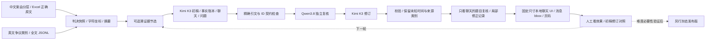

# v2 独立合成 block

最新一轮为 [round_002](../../datasets/v2.0.0/round_002/REPORT.md)：因首轮自然感不足，直接写作并复审中英文各一案，新增手机 HTML 渲染及对照页。复现命令见该报告。这一轮没有新增生成模型 API 调用；下面仍是首轮模型流水线的历史入口，并未自动切换到手写样本。

当前使用历史判决来源、新 prompt、新模型生成第一轮中英文开发候选。目录和模型调用均与 v1 评测隔离；中文来源判决与历史池重叠，所以只能作为开发样本，不能声称新的独立测试集。

```powershell
.\.venv\Scripts\python.exe blocks/synthesizer/scripts/run.py prepare
.\.venv\Scripts\python.exe blocks/synthesizer/scripts/run.py run --critic kimi26_nonthinking
.\.venv\Scripts\python.exe blocks/synthesizer/scripts/run.py audit
.\.venv\Scripts\python.exe tools/attach_v2_legacy_baselines.py
.\.venv\Scripts\python.exe tools/curate_v2_round1.py
.\.venv\Scripts\python.exe blocks/synthesizer/scripts/run.py report
.\.venv\Scripts\python.exe tools/verify_v2_round1.py
```

`run` 实际调用配置的 API；已成功阶段按 prompt 摘要复用，不重发。失败保留在 response.json，不以空内容替代。`report` 仅离线生成本地样式截图和报告，结构/引用错误的候选不生成截图。主配置只引用既有凭据位置，不复制密钥。

本轮原定 Qwen3.8 复核返回 402 余额不足，实际使用上方 `--critic kimi26_nonthinking`。`audit` 是额外的真实调用阶段，只看聊天与题目，检查答案泄漏。`curate_v2_round1.py` 是本轮具体问题的可重现修复，不能直接当成下一轮通用黄金规则。并发恢复必须避免同一 case 同时运行；入口现在对新 stage 请求加锁，并额外保留每次调用记录。已执行时有一次英文借款修订发生并发重复，阶段汇总不当作完整计费记录。

`config.yaml` 的 generator、critic 和 inference_mode 可替换；local 需要另配正在服务的本地兼容 endpoint。准备后的配置和来源发生变化须新建 round，不覆盖旧运行。



本轮模型评分尚未对齐飞书人工量表。没有用旧测试错误逐题调生成器，没有宣称 SOTA 或自动证明困难度。研究困难度需要独立评审、证据移除、单图/多图对照和文本捷径检查。
