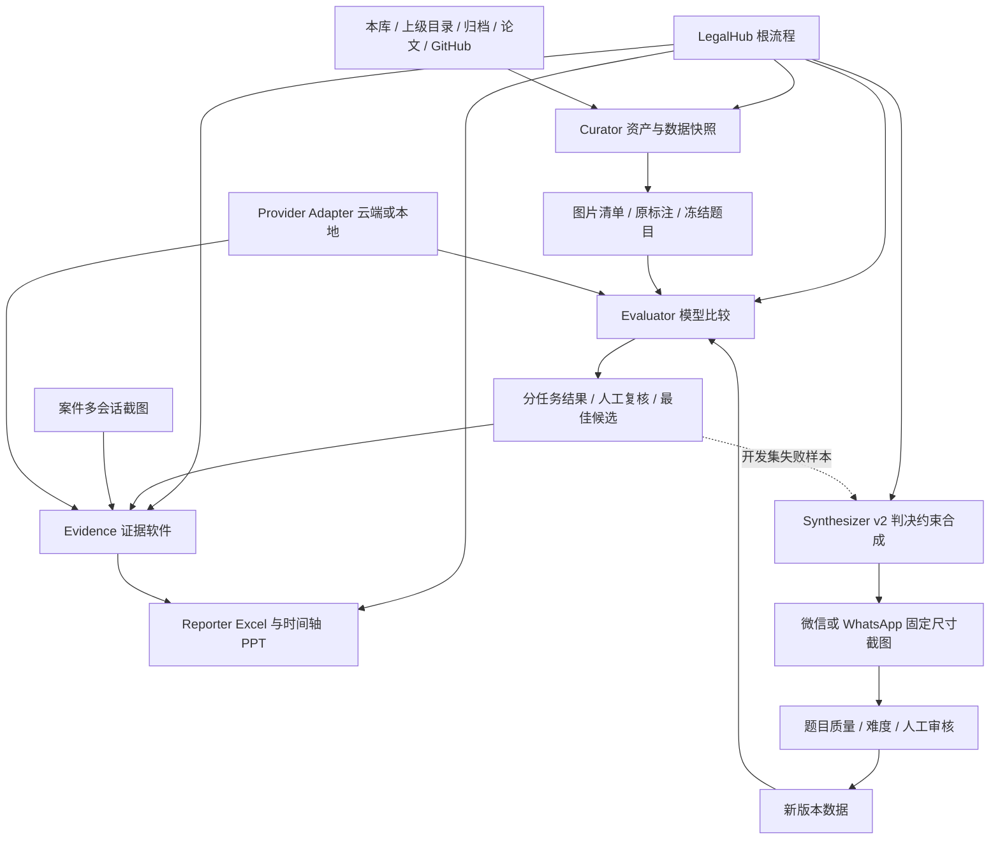
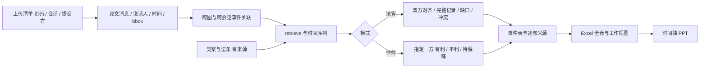

# 重启架构、资产接入与缺口

核验日期：2026-10-04。执行顺序：旧数据模型评测 → 按结果实现证据软件并运行 → v2 数据质量和合成飞轮。目前完成资产冻结、预检和离线基线，尚无新的 SOTA 得分或可验收的软件。

## 资产接入

主图片在 `projects/ScreenshotLegalBench_v2/process_local_evaluator/images/`，1,088 张；`projects/quiz-collector/images/` 补齐其余 82 张。合并索引有 **1,170 个图片文件名**，所有 154 条案件级多图问题输入完整。[图片清单](../reports/restart/images_manifest.json)保留原始路径、SHA256、尺寸和副本别名；[资产报告](../reports/restart/ASSET_RESTART.md)列出飞书表格与可执行入口。

合并后 313 个文件名前缀、225 个多图组。这只是文件分组，不等同验证过的司法案号或多跳标注。源标注 1,176 条包括 6 条重复图片记录，当前保留历史权重并披露。不同文件名还有 2 组相同图像内容。现有 8 条评测 track 包括分类、证据形式、群聊/私聊、单图案由、多图案由开放/选择、消息辅助文本/仅图片两种输入，分别报告。

| 来源 | 已确认用途 | 接入模块 |
|---|---|---|
| ScreenshotLegalBench_v2 | 判决抽样、聊天生成、KIE、IoU 和消息题 | curator / evaluator |
| quiz-collector | 原图补充、多图问题、人工答题 | curator / evaluator / 人审 |
| llm_evluator | prompt 迭代、人工评分一致性、飞书服务、截图脚本 | v2 quality / synthesizer |
| Batch | 英国判决正文补抓 | 英文判决来源 |
| labelU-Kit、PaddleLabel、Label Studio | 标注工具候选 | v2 按需择一 |
| silicon-pool | 可选模型网关 | provider adapter |
| law_gpt、crawler-law、law-tools | 法律采集或旧前端 | 按实际需求接入 |
| whatsapp-collection | WhatsApp UI 原型，含 whatsapp-simulator | v2 固定视口渲染候选 |
| LightRAG、ragflow | 检索候选 | retrieve adapter |

本次覆盖当前库、`D:/workspace` 与上一级 `D:/` 的顶层发现，对 16 个相关本地项目做定向文件盘点；不穷尽扫描整个磁盘、模型权重或私人消息目录。[本地清单](../reports/restart/local_inventory.json)列明范围，原有迁移副本和上级目录资产保留。

GitHub 连接找到 [ValeriaWong/wechat_screen_vqa_dataset](https://github.com/ValeriaWong/wechat_screen_vqa_dataset)，`image/`、`JPEGImages/` 各有 4,559 个图片路径。全仓库 15,411 个图片路径对应 4,850 个不同 Git blob，很多属于重复实验输出，不能当作新样本。树快照 `8ec407df4ceb0c86634e982310b862167754fcf8` 未截断。[GitHub清单](../reports/restart/github_vqa_inventory.json)已保存，相关文本/标注回收到 `projects/wechat_screen_vqa_dataset/`，图片未全量下载。

根目录 `pipeline.py` 为空，`cogvlm_req_star.py` 是 PDF 图像流程，尚未在已读根文件中找到完整法律 VQA 榜单入口。`train/val/test.json` 为 40/5/5 张 COCO 检测图、714/129/102 个框；训练/验证共享 2 个图片前缀，训练/测试共享 1 个，不能默认是按案件隔离的问答测试集。保存的 `split_dataset.py` 会移动文件，本次未运行。

当前 GitHub 连接可见 ValeriaWong 的 5 个仓库，不代表账号所有仓库。`law_gpt` 与本任务有关，`Trademark_Appeals` 为其它法律任务候选。

## 评分资产与论文版本

归档含 17 个有效顶层文件和一个嵌套 ZIP，已恢复中文文件名、SHA256 和 Markdown。飞书 Excel 的 `A1:A1` 错误尺寸声明会导致漏读，本次按完整行流读取，原件未修改。[archive_inventory.json](../reports/restart/archive_inventory.json)保留各 sheet 的表头与物理行列数。

`prompt迭代.xlsx` 主表 403 个物理行、19 列，含 prompt、模型、task_id、评分说明、修改方向和 Spearman 记录。剧本泛化测试有 14 个 sheet。`prompt_v3——v9` 有 351 条表头后数据行、337 个非空案号，严/许/惠/钱评分非空数分别为 175/175/191/175。[评分覆盖](../reports/restart/human_score_coverage.json)可用于恢复实验。不同评分员取值范围、缺失与版本不同，不能直接混算相关系数；物理行数也不等于有效评分数。

已抽取 103 页毕业论文、dataset_final 两版和完整 JSON 评估 prompt 的文本，[来源索引](../reports/restart/thesis_text/index.json)可定位原件。论文报告约 5,000 张图、4,600 余结构化样本、1,100 余 VQA，并描述 143 张/696 条消息的 KIE 测试子集。这些不是当前文件的同一计数单位/快照。论文分类 457/21/664/34 与当前 410/19/711/36 不同，需保留版本边界。

嵌套“论文数据代码路径一览”提供英文路线的具体线索：`/home/allen/code/EnglandJudgment/` 下有判决、聊天提取、WhatsApp KIE 和排序，例如 `out/cases_core_fields.jsonl`、`results.enriched.jsonl`、`datasets/screenshot_whatsapp/layout_ocr_multi.json`。这些脚本/产物尚未在当前本地清单和可见仓库中定位。

两个私人 ChatGPT 项目本次无法读取：浏览器工具无可用浏览器，创建 tab 失败。旧蓝图的聊天摘要只作为历史线索，不能当作本次重新读取的原始对话或已复现实验。私人链接没有传给其它 agent，也不写入共享配置或清单。

## LegoFlow 模块架构

借用 LegoFlow 的 block 契约：模块明确配置、输入/输出、脚本和运行产物，根流程按依赖协调。这里的 blocks 按法律截图任务定义，v1 无需同时引入训练集群。[官方架构](https://github.com/LegoX/LegoFlow)、[Block 设计](https://legoflow-docs.legox.net/docs/development/block-design)。



当前 curator 和数据准备已可执行；evaluator 完成离线准备与检查，待真实请求。evidence、reporter 和 v2 合成是后续实现边界，图中的箭头不表示功能已验收。



法官模式用双方可见材料对齐记录，缺失内容标为缺口。律师模式保留不利标注及可筛选工作视图，完整来源仍可追溯。每个事件/意思表示保留 `image_id / evidence_page / message_id / bbox / quote`，多图事件保存全部出处。时间缺年/月/日期时保留原文、粒度与不确定性，跨会话身份有证据才合并。

retrieve 保留案件内部检索、类案检索与请求权基础/法条需求，以独立 adapter 给出来源。具体交接见 [数据契约](data-contracts.md)，操作边界见 [skills 拆分](skill-map.md)。旧资产放 `projects/`，新 adapter 放 `legalhub/`，模块配置与产物放 `blocks/`，skills 和报告分别管理。

## 缺口与验收顺序

| 优先级 | 缺口 | 下一步 |
|---|---|---|
| v1 P0 | 模型供应商/网关、准确视觉型号、比较范围与费用上限 | 用户配置；旧 YAML 含文本模型及旧型号，不能默认当新 SOTA |
| v1 P0 | 原 VQA 评分入口与运行快照 | 新 adapter 已接题目，但论文 Hit Rate/Similarity/Length 的旧实现仍待找回 |
| v1 P0 | 开放法律问答评分口径 | 专家评分或经人工校准的 grader，不能靠文本重合值选专业模型 |
| v1 P0 | 143 图/696 消息人工 KIE 快照、权重与代码 | 查原训练机/Linux产物，现存 450 条结构化 JSON 不能默认等价 |
| v1 P1 | 多图证据理解、双边对齐、有利性、retrieve 软件 | 模型比较后实现并实际启动 |
| v1 P1 | 带逐句来源的 Excel 和时间轴 PPT | 消费同一事件表，后续接用户提供的 PPT 审美 skill |
| v2 | EnglandJudgment 英文工作目录 | 找回判决、提取/排序代码与实际产物 |
| v2 | 事件/跨会话/时序及最小证据集合金标 | 旧集的多图问答不足以证明已覆盖全部能力 |
| v2 | 引文/转述/合成来源、固定渲染、案件 split、难度分层 | 新版本完善，开发集迭代，冻结测试集不调 prompt |
| 补充 | 私人项目原始对话 | 当前不可读，可由本地导出补充对账 |

v1：同一冻结集实测模型、产出报告 → 选默认模型实现完整软件 → 启动服务，以多图输入验收事件、retrieve、引用和导出。尚无真实模型结果时不写“最佳模型”，未运行软件时不宣布 v1 完成。

## 已能运行的步骤与 v2 飞轮

在仓库根目录执行：

```powershell
py -3.10 tools/restart_inventory.py
py -3.10 -m legalhub.benchmark prepare
py -3.10 -m legalhub.benchmark check
py -3.10 -m tools.evaluation_readiness
```

模型配置参考 `configs/models.example.yaml`，实际配置放 `configs/models.local.yaml`，密钥从环境变量读取。`run` 不带 `--execute` 不发请求。已配置模型后可用 `--limit 8` 预检；冒烟检查不能当无偏正式评测。`--output` 恢复同一配置，数据/模型/prompt 变化会拒绝混用。当前 adapter 支持 OpenAI 兼容 `/chat/completions`，其它原生协议需接 adapter；本地模式需正在服务的视觉模型。

目前没有人民币费用自动熔断，先确定上限并用小批次核算费用后全量。运行保存 hash、计划任务、原始回答、供应商返回型号、usage、延迟和失败。旧 KIE runner 保留，KIE 与 VQA 分开报告。新候选须核对官方发布与网关可用型号。[Claude 发布](https://www.anthropic.com/news)、[Gemini 模型](https://deepmind.google/models/)、[Qwen 说明](https://qwen.ai/blog?id=qwen3.5)。

离线多数类基线：私聊常量预测 accuracy 97.10%、Macro F1 约 0.4927；截图分类常量预测 accuracy 60.46%。这是不平衡诊断，不能证明多图法律推理整体简单，见 [评测准备报告](../reports/v1.0.0_model_evaluation.md)。

v2 分开检查事实忠实性、自然性、可回答性、法律复杂度、证据跳数、跨会话、时间歧义和矛盾证据。保存最小证据集合，以移除关键图等受控对照检验是否实际使用证据。中文判决→微信、英文判决→WhatsApp，逐字引文/转述/生成补充分开，固定视口分页并保存消息到区域映射。开发失败 → 生成候选 → 人审/grader 校准 → 新数据版本 → 评测 → 产品复核构成飞轮；同判决衍生数据留在同一 split。

已建 8 个仓库 workflow skills，未安装全局。后 6 个定义的是实现边界，尚非可运行软件。已运行图片核验、飞书行流读取、数据冻结、全量来源哈希预检、离线基线与评测契约测试，未执行真实 SOTA 推理或律师软件端到端验收。
