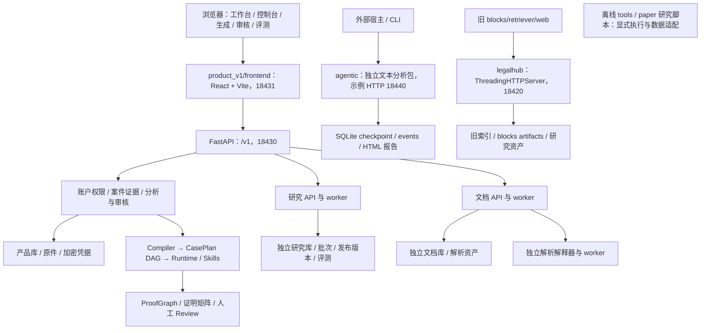
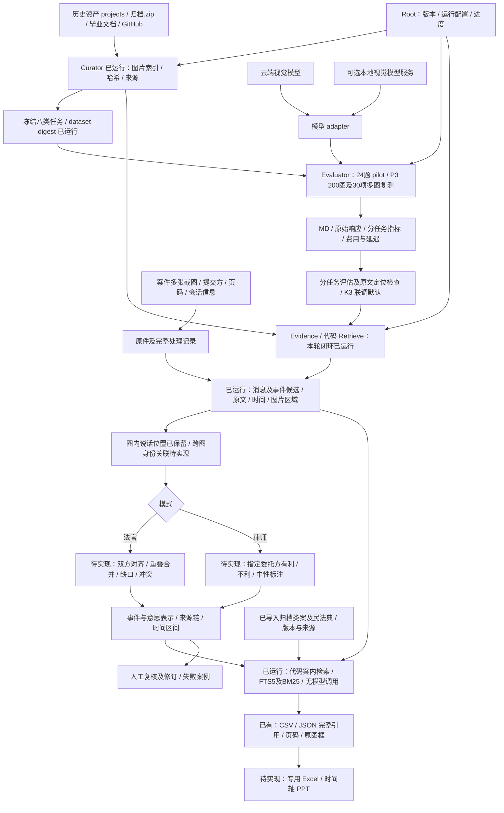
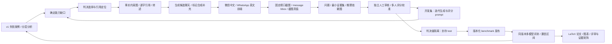

# ScreenshotLegalHub 当前架构

核验日期：2026-11-17。以下当前结构来自源码静态核验；未在本轮启动服务、重跑应用测试或调用模型。后半部分保留历史架构记录。

## 当前系统与部署边界

图中的 `agentic`、`legalhub` 与产品不是已集成的统一执行引擎。三个源码包未发现相互运行时导入；离线迁移工具仍可能依赖旧包和仓库资产。四类产品入口是同一应用的业务边界，五个 HTML 入口并不代表五个独立服务。

## 目录、入口与数据归属

| 位置 | 当前职责与关键文件 |
| --- | --- |
| `product_v1/backend/src/screenshotlegal/api/main.py` | `create_app` 组合服务、注册 API，并在 lifespan 管理研究和文档 worker |
| `domain`、`application/ports`、`application/services` | 领域契约、能力接口与业务用例；`workspace.py` 仍直接组合基础设施和 Runtime |
| `runtime`、`plugins`、`infrastructure` | DAG 执行、能力注册、持久化、模型网络及原件存储；`stage_executor.py` 仍依赖应用层 proof 和具体 Skill 工厂 |
| `research`、`experiments`、`method_reproductions` | 研究批次、合成、审核发布、评测及方法适配，与案件业务共享应用入口和账户体系 |
| `documents` | 文档注册、任务和解析适配；`adapter.py` 通过独立解释器执行解析 worker |
| `product_v1/frontend` | `vite.config.ts` 注册五个 HTML 构建入口；`src/main.tsx`、`console.tsx`、`research.tsx` 启动对应界面 |
| `agentic` | `core.py` 管理运行、DAG、预算；`builtin/workflow.py` 定义五阶段；`state.py` 管 checkpoint；`adapters` 提供平台接入；`report.py` 渲染报告 |
| `legalhub`、`blocks/retriever/web` | 旧 Python HTTP 服务、检索/问答/时间轴/批注与原生前端 |
| `blocks`、根 `tools/tests`、`paper`、`configs/v3` | 研究与数据流水线；不会随产品启动自动全部运行，复现依赖各自资产和环境 |

产品数据根由 `screenshotlegal/settings.py:Settings.data_dir` 指定，默认是 `product_v1/data`。主库为 `screenshotlegal.sqlite3`，研究库为 `research/research.sqlite3`，文档库为 `documents/documents.sqlite3`；凭据主密钥为数据目录内 `.credentials/model-master.key`。整个数据目录、备份和原件均排除提交。旧索引默认位于 `blocks/retriever/artifacts/index.sqlite3`。独立 Harness 的持久化由宿主指定；示例 CLI/HTTP 使用临时库，不能当作长期保存服务。

## 执行链与已知限制

- 产品：Matter Pack → Compiler → CasePlan DAG → 分阶段 Skills → ProofGraph/证明矩阵 → 人工 Review；文档解析与研究任务分别有 worker。分层已存在，模块化单体重构建议尚未全部实施。
- 独立 Harness：Planning → Facts → Assessment → Gaps → Synthesis，每阶段先执行确定性 Tool，再按配置调用模型并做 Review/有限修复。它只接收已转写文本，不包含 OCR、PDF 解析或产品完整案件契约。
- 文档解析默认使用产品 `.tools/mineru-env`，可由 `DOCUMENT_PARSER_PYTHON` 覆盖；这不表示后端环境已安装完整 OCR 能力。
- 用户工作台的 `MockPresentationGenerator` 只返回模拟 PPT 预览。程序验证、规则 Review 与法律专业认证分别验收。
- 当前 Vite 开发配置和产品 `Settings.host` 默认为 `0.0.0.0`，实际监听仍由启动命令决定；旧线和 Harness 示例 HTTP 绑定回环。端口 18420/18430/18431/18440 是代码约定，本轮未做运行可达性验收。

源码与本地数据的提交边界见[仓库安全说明](REPOSITORY_SAFETY.md)。更细的产品和独立包说明分别见[产品架构](../product_v1/docs/ARCHITECTURE.md)、[Harness 架构](../agentic/docs/04-architecture.md)。

## 历史架构记录

> 2026-10-24：当前仓库职责、源码依赖与模块化改造建议见[架构盘点与重构方案](architecture/REFACTOR_PROPOSAL.md)。下文保留各时期架构记录；目标目录与端口方案尚未实施。

## 2026-10-22 架构补记

当前综合状态见[AI文档中心](ai_docs_center/README.md)和[V3阶段评估](ai_docs_center/PROGRESS.md)。下方原有图及Block表是2026-10-04旧软件/研究基线；不能据其第一轮描述判断后续工作未做。

| 软件/研究线 | 实际结构与边界 |
|---|---|
| `legalhub`（18420） | 原有Python工作台：检索/转录/问答/来源/法律批注；[v1.2.0验收](../reports/v1.2.0_legal_review_workspace.md) |
| `product_v1`（API18430/UI18431） | 独立FastAPI/React；domain/application/plugins/runtime/infrastructure/api；Matter Pack→CasePlan DAG→ProofGraph/Matrix→审核历史/SSE；账户/协作/导入/模型设置已扩展；[产品架构](../product_v1/docs/ARCHITECTURE.md) |
| V2 | 四轮候选已独立保存；[第三轮](../datasets/v2.0.0/round_003/REPORT.md)与[第四轮](../datasets/v2.0.0/round_004/REPORT.md)是当前候选进展；尚无专业认证 |
| V3 | S0–S7尚未阶段验收；认证依赖图、充分路径/结论一致性、完整双模式及专用Excel/PPT需另行接入和回归 |

新产品运行时不依赖旧legalhub、根模型配置或旧数据库；旧数据适配通过[显式迁移工具](../product_v1/docs/MIGRATION.md)，目前仅合成迁移验收。具备ProofGraph/缺证线索不等于V3证据充分性认证。

## 2026-10-04 旧架构基线

核验日期：2026-10-04。图中标明当前可运行部分与待实现部分。参考 [LegoFlow 官方架构](https://github.com/LegoX/LegoFlow) 的 block 合约：各阶段拥有配置、脚本、skills、依赖索引和运行产物；不直接搬用其 SWE 数据采集、代码执行奖励或训练流程。

## v1.0.0：先实跑，再选型，再交付软件

Judge 仅重建双方材料共同支持的可观察聊天；未提交或截断的内容呈现为缺口。Lawyer 支持不利标注、律师选择工作视图及导出范围，保留原始材料和完整来源记录。两者均不得把推断时间写成可见时间。

## v2.0.0：开发数据飞轮与冻结评测分开

Test 的答案和失败细节不用于逐题优化生成器或评分器；飞轮使用开发集与新候选池。下一轮发布新版本时，旧 test 保留为历史对照。困难样本需经证据移除、跨图必要性和文本捷径检查，不能只靠增加图片数或把语言写复杂。

## Block 对应与当前状态

| Block | 代码或资产 | 状态 |
|---|---|---|
| curator | tools/restart_inventory.py、tools/research_assets.py | 已运行 |
| evaluator | legalhub/benchmark.py、tools/iterate_v1_p3.py、旧 KIE runner | 已有真实 pilot；P3 复测；全量八轨及专业法律评分待完成 |
| evidence | legalhub/evidence.py、tools/extract_evidence.py | 已有真实抽取及完整上传闭环；事件及身份仍需复核 |
| retriever | legalhub/retrieval.py、legalhub/app.py、blocks/retriever/web | 代码查询、来源查看、类案/法条、大事记及导入已运行 |
| reporter | retriever export_rows、legal-exports skill | 已有完整引用 CSV/JSON；专用 Excel/PPT 待实现 |
| synthesizer / quality | blocks/synthesizer、legalhub/synthesis.py、历史评分及飞书导出 | v2 第一轮中英文 6 案已生成复核修订，待人工看效果；评分校准及难度验证仍待执行 |
| research | paper/、reports/research/、legal-paper skill | 资产核查及工作稿；实验待补 |

完整来源和缺口见 [重启核查报告](../reports/research/RESTART_FINDINGS.md)。

本轮 v2 的可运行阶段与模型替换见 [synthesizer 架构图](../blocks/synthesizer/README.md)，结果见 [第一轮报告](../datasets/v2.0.0/round_001/REPORT.md)。新目录与 v1 存储隔离；中文来源判决与历史生成池重叠，本轮定位为 development，不能当成新的独立 test。
