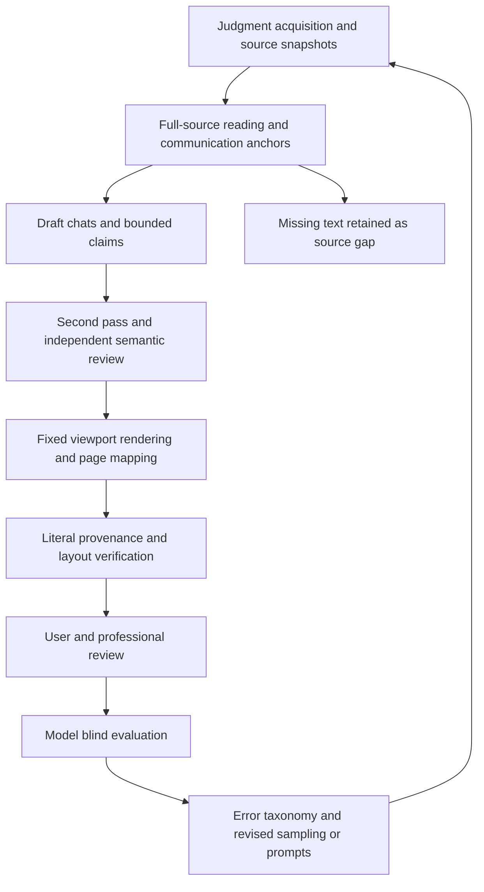

# Authoring and evaluation protocol

## Source ledger

For each source record store its URL/path, retrieval date if external, source text hash, raw container hash, full text, paragraph or chunk character ranges, case number as stored and corrected display value if needed. Historical cause labels remain historical; mismatched administrative/civil labels require explicit correction before inclusion. Do not merge separate judgments to fill a single case's missing conversations.

`source.reading.json` needs exact `source_chars`, `source_paragraphs` and full-read constraints. `codex.review.json` needs `full_judgment_read: true`, concrete `issues` with `problem` and `change`, or an honest empty list. A self-review is not an independent review. `source_refs` use `source_id`, `quote`, and preferably explicit `char_start`/`char_end`; use `source_end_id` if the quote crosses stored chunks. Stored chunks are locator units, not official court paragraph numbers.

The current cohort uses full-source Chinese direct authoring. For English use the same rules with WhatsApp, preserve original language, jurisdiction and legal standard, and use a renderer that supports it. Do not pretend the current round is bilingual when no English artifacts were produced.

## Claims schema

```json
{
  "claims": [{
    "id": "cs1",
    "claim": "The displayed statement establishes a particular proposition.",
    "task_mode": "image_only",
    "label": "insufficient",
    "answer": "A bounded answer justified by the visible material.",
    "reasoning": "Which inference is missing and why.",
    "evidence_message_ids": ["m001"],
    "source_refs": [{"source_id": "p0010", "quote": "literal source span"}],
    "missing_evidence": ["confirmation or transaction linkage"],
    "insufficiency_type": "statement_not_performance"
  }]
}
```

For `case_context` additionally provide the exact `context` that models receive. `supported` means the proposition is supported by the supplied material within its stated scope; “A claimed X” is narrower than “X really happened.” `contradicted` needs visible opposite evidence. `insufficient` means neither sufficient support nor a grounded opposite conclusion. It is not a fourth court outcome or a statement that evidence is forged.

Useful dimensions: identity unverified, statement versus performance, consent not shown, scope mismatch, time uncertain, authenticity unverified, causal link missing, claimant statement only, object linkage missing, amount scope mismatch. Keep cause and reason as separate labels. Do not invent 200 negative reason types to meet a numeric target.

Examples:

- “借的什么时候还” supports that its sender sought repayment. It does not show the recipient's acknowledgement or a principal amount.
- “如果他减肥下来了，我马上从我帐上转50万元给他” expresses a conditional reward. It contradicts “the message promises an unconditional immediate reward”; it is insufficient for “50万元 has already arrived.”
- Two parties' screenshots may resolve completeness. A source that says only “two screenshots were submitted” cannot supply the unseen messages. Keep such sources for provenance/context studies or acquire better material.

## Difficulty and balance

Sample by cause and insufficiency reason, report actual feasible counts rather than forcing every cell equal. Include supported and clearly contradicted controls when sources permit them. Report macro metrics by claim label, cause and failure mode, majority baseline, supported-to-insufficient confusion, citation correctness and overclaim rate. Define overclaim rate as insufficient gold candidates predicted supported, and qualify it while annotations are provisional.

Split by judgment family, related trial/appeal and reconstructed conversation family, not screenshot or paraphrase. Current rounds remain `development`; grouping by raw text hash alone does not stop related-judgment leakage. Human legal reviewers must verify labels and minimum evidence page sets before a held-out paper test release. Hardness must come from evaluated model errors and substantive reasoning, not page count, OCR noise or automatic score prompts alone.

## Flywheel



Freeze reviewed outputs before each loop. Save failures and deferrals, candidate selection rules, actual revisions, model response logs when available, and changes after evaluation. Additions generated from model errors stay in development until a new test split is fixed.
